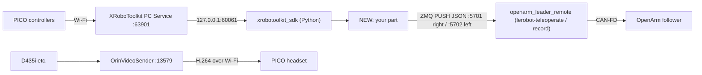

<!--
Notion から取得した本文をそのまま保存したもの（Notion-flavored Markdown。要約・編集なし）。
- 元ページ: 🎮 20261028 PICO controller teleop for OpenArm — request to Sho / PICO コントローラ テレオペの依頼
- URL: https://app.notion.com/p/407194a1c562816fb3a8daadec79fd5a
- 場所: Kota0 / Free Space - フリースペース / Uchiyama's Notes - 内山のメモ
- Notion の最終編集: 2026-10-30T11:53:49Z ／ 取得: 2026-10-31（Kota の PC の Claude Code・操作は Kento）
- 注: 依頼元が伝えた ID（…40ad8236d6178075…・…40ad8236d6178037…）は、このアカウントから開けなかった（404）。タイトル検索で見つかったのはこの 1 ページだけ。
- ファイル名の「/」は「-」に置き換えた。
-->

<callout icon="📌" color="gray_bg">
<b>For:</b> <mention url="user://708c9a14-67a6-40b1-b067-2a682b019696" /> (Sho) · <b>From:</b> Kento · <date start="2026-10-28" />

This page collects what already exists, where the code is, how to set it up, and the known pitfalls, so that you can build the part that drives OpenArm from the PICO 4 Ultra controllers. <b>The control design is not decided — that is yours to decide</b> (see section 7). Japanese original is at the bottom.

Full design docs (Japanese, added 2026-10-30): <mention url="https://app.notion.com/p/409194a1c5628177b1d8cb1b8368a34d" /> (PICO video path: design, build steps, latency fixes, troubleshooting) and <mention url="https://app.notion.com/p/409194a1c56281aeb580c9f4aeb794c7" /> (remote teleop: the <code>openarm_leader_remote</code> receiver, safety on packet loss, first-time setup). These two are frozen archive copies (git: <code>Orboh/doma-sorting-dev</code>, folder <code>08-archive/openarm-vla-2610/</code>); the originals live in Kento's vault, so ask Kento if something looks outdated. Questions go to the Slack thread in #kota0-スポット.
</callout>

## 1. The request

- <b>Build:</b> the part that reads the PICO 4 Ultra controllers (hand position / orientation and buttons) and moves the OpenArm follower.
- <b>No need to build:</b> the video. The path that shows OpenArm's camera in the PICO headset with low latency was finished in Aug 2026 and is reused as-is (2.1).
- <b>Up to you:</b> how to control it. Nothing in section 7 is decided.
- <b>The output side already exists:</b> the follower has a receiver (<code>openarm_leader_remote</code>) that takes joint angles over the network. Today the leader-arm PC sends to it. If you produce joint angles in the same format from the PICO input and send them, the follower side runs without code changes (section 3).

---

## 2. What already exists

### 2.1 Video (PICO FPV — done)

- Path: camera (D435i RGB) → <code>OrinVideoSender</code> (H.264, x264 zerolatency, 4 Mbps, \~29 fps) → Wi-Fi → XRoboToolkit app on the PICO.
- On 2026-08-24 an operator teleoperated with the leader arm from another room, looking only at the PICO view, and picked a bottle into a basket.
- The "lag keeps growing" problem was fixed on 2026-09-01 (on congestion it freezes briefly, then catches up to the newest frame).
- When recording (<code>lerobot-record</code>) at the same time, <code>start-collection-cameras.sh</code> splits the real cameras into virtual cameras (the PICO feed is the chest camera with a small wrist-camera window).

### 2.2 Follower-side receiver (<code>openarm_leader_remote</code> — done)

- A Teleoperator in our lerobot fork. Plugs into <code>lerobot-teleoperate</code> / <code>lerobot-record</code> with <code>--teleop.type=openarm_leader_remote</code> (recording CLI unchanged).
- Receives JSON via ZMQ PULL (CONFLATE=1, newest sample only). Ports: right arm 5701, left arm 5702 (RTT echo 5711 / 5712).
- Safety behavior: does not start following until the first packet arrives (exits after 30 s); checks that the first pose is within joint limits; on 250 ms of silence it <b>holds the last pose (never goes limp)</b>; on resume it interpolates over 1 s before following again.
- Worked on the real arm on 2026-08-24 (RTT p50 = 14.2 ms, p99 = 161.7 ms, 196 Hz for 7 min, no hold triggered).

### 2.3 IK starting point (partly verified)

- <code>ik/openarm_left_ik.py</code> in openarm-orboh: damped least squares with pinocchio. Left arm, 7 DOF, end effector = gripper tip (<code>openarm_left_hand_tcp</code>).
- <code>solve(target_SE3, q_seed, position_only=True|False)</code> — position only, or full 6-DOF pose. Includes degree ↔ radian helpers for lerobot.
- Status: offline FK/IK round trip passes (position error \< 1 mm). On the real arm only zero point and joint signs were checked; actually reaching a target was <b>not</b> verified. <b>There is no right-arm IK.</b>
- It was written for coarse approach in grasping, not for teleop.

### 2.4 Reading the PICO input (used on G1)

- PICO app → Wi-Fi → <b>XRoboToolkit PC Service</b> (daemon on a PC, waits for the PICO on TCP 63901) → Python <b><code>xrobotoolkit_sdk</code></b> (connects to the service at 127.0.0.1:60061).
- Main functions: <code>get_right_controller_pose()</code> / <code>get_left_controller_pose()</code> (<code>[x, y, z, qx, qy, qz, qw]</code>), <code>get_right_trigger()</code>, <code>get_right_grip()</code> (analog), <code>get_A_button()</code> etc., <code>get_headset_pose()</code>.
- We used it in Jul–Aug 2026 for G1 whole-body teleop. Video (Remote Vision → Listen) and controller input (PC Service) worked at the same time in the same app.
- For video only, PC Service was not needed. For controllers it is.

---

## 3. Inputs, outputs and overall layout

<b>Input (from the PICO):</b> controller position / orientation (in the headset's tracking space), trigger and grip (0–1), A/B/X/Y and sticks. The PICO sends them over Wi-Fi to the PC Service; your code reads them with <code>xrobotoolkit_sdk</code>.

<b>Output (to the follower):</b> one JSON message = one sample, per arm. Joint angles are in lerobot degrees.

```json
{"seq": 12345, "t_mono": 172.031250, "arm": "right",
 "action": {"joint_1.pos": 1.2, "joint_2.pos": 0.0, "...": "...", "joint_7.pos": 0.0, "gripper.pos": -12.0}}
```

- <code>seq</code> = running number, <code>t_mono</code> = sender's <code>time.monotonic()</code> (no clock sync assumed).
- Send to the PC that drives the follower: port 5701 (right) / 5702 (left). ZMQ PUSH, CONFLATE=1.



Today the <code>NEW</code> box is <code>leader_agent</code>, which reads the leader arm at 200 Hz. Its send loop, for reference (lerobot fork, <code>leader_agent.py</code>):

```py
ctx = zmq.Context()
push = ctx.socket(zmq.PUSH)
push.setsockopt(zmq.CONFLATE, 1)
push.setsockopt(zmq.LINGER, 0)
push.connect(f"tcp://{cfg.remote_host}:{cfg.remote_port}")
...
seq += 1
msg = {"seq": seq, "t_mono": now, "arm": cfg.arm, "action": {k: (None if v is None else float(v)) for k, v in action.items()}}
try:
    push.send_string(json.dumps(msg), flags=zmq.NOBLOCK)
except zmq.Again:
    dropped += 1
```

IK API, for reference (openarm-orboh, <code>ik/openarm_left_ik.py</code>):

```py
class OpenArmLeftIK:
    def fk(self, q) -> pin.SE3: ...
    def solve(self, target: pin.SE3, q_seed, position_only: bool = True,
              max_iter: int = 300, eps: float = 1e-4, damp: float = 1e-4, dt: float = 1.0):
        """returns (q, converged, iters, final_err6)"""
    def solve_position(self, xyz, q_seed, **kw): ...
    def clamp(self, q): ...
    def within_limits(self, q) -> bool: ...

def lerobot_obs_to_q_rad(obs: dict) -> np.ndarray: ...   # deg (joint_1..7.pos) -> rad
def q_rad_to_lerobot_action(q_rad) -> dict: ...         # rad -> {"joint_k.pos": deg}
```

---

## 4. Hardware (Kitakyushu office, as of 2026-10-28)

- OpenArm, both arms (leader and follower), CAN FD box, emergency stop button
- PICO 4 Ultra × 1 (the other one is in Itabashi)
- D435i (chest), D405 × 2 (left / right wrist), USB hub, router
- The Jetson Thor stayed in Itabashi. In Kitakyushu the follower is driven over CAN from a PC there.

---

## 5. Repositories and code

| Repository | Branch | What you use there |
| --- | --- | --- |
| Orboh/openarm-orboh | dev/openarm-vla | Launch scripts (<code>scripts/run_teleop_remote_{left,right}.sh</code>, <code>run_leader_agent_{left,right}.sh</code>, <code>canup.sh</code>, <code>start-collection-cameras.sh</code>), IK (<code>ik/</code>), URDF (<code>urdf/openarm_v10_bimanual.urdf</code>), start-pose sets (<code>config/pose_sets/</code>) |
| Orboh/lerobot (fork) | feat/bi-openarm-soft-move-to | <code>src/lerobot/teleoperators/openarm_leader_remote/</code> (receiver, <code>leader_agent.py</code>, <code>remote_probe.py</code>) |
| Orboh/XRoboToolkit-Orin-Video-Sender (fork) | vector-x86 | Video sender |
| XR-Robotics/XRoboToolkit-PC-Service | Releases v1.0.0 | PC Service (x86 / arm64 .deb) |
| XR-Robotics/XRoboToolkit-PC-Service-Pybind | main | xrobotoolkit\_sdk |
| XR-Robotics/XRoboToolkit-Unity-Client | Releases v1.1.1 | PICO app (APK) |
| XR-Robotics/XRoboToolkit-Teleop-Sample-Python | main | Reference only: drives UR5e etc. from PICO controllers in MuJoCo / placo / hardware |

Links: [openarm-orboh](https://github.com/Orboh/openarm-orboh/tree/dev/openarm-vla) · [lerobot fork](https://github.com/Orboh/lerobot/tree/feat/bi-openarm-soft-move-to/src/lerobot/teleoperators/openarm_leader_remote) · [Video sender](https://github.com/Orboh/XRoboToolkit-Orin-Video-Sender/tree/vector-x86) · [PC Service](https://github.com/XR-Robotics/XRoboToolkit-PC-Service/releases) · [Pybind SDK](https://github.com/XR-Robotics/XRoboToolkit-PC-Service-Pybind) · [Unity client](https://github.com/XR-Robotics/XRoboToolkit-Unity-Client/releases) · [Teleop sample](https://github.com/XR-Robotics/XRoboToolkit-Teleop-Sample-Python)

Clone and setup: follow <mention url="https://app.notion.com/p/3fc194a1c562811ca8bbf9437d45740c" />. Note: that guide still names the lerobot branch <code>thor/openarm-bimanual-20261014</code>, which was retired on 2026-10-17. The current one is <code>feat/bi-openarm-soft-move-to</code> (<code>bootstrap.sh</code> already picks it).

---

## 6. Setup and running

1. <b>Install and start PC Service</b> (on the PC that reads the input). Install the .deb from Releases with <code>sudo dpkg -i</code>. The bundled <code>run2D.sh</code> fails on its GUI part, so start the main process directly:

```bash
cd /opt/apps/roboticsservice && \
LD_LIBRARY_PATH=/opt/apps/roboticsservice:/opt/apps/roboticsservice/lib:/opt/apps/roboticsservice/SDK/x64 \
nohup ./RoboticsServiceProcess > /tmp/roboticsservice.log 2>&1 &
ss -tlnp | grep -i robotics   # running if *:63901 and 127.0.0.1:60061 show up
```

2. <b>PICO app (first time only):</b> enable developer mode and turn Safeguard off, download APK v1.1.1 in the PICO's built-in browser, install it from File Manager.
3. <b>Connect the PICO:</b> in the app, enter the input PC's IP in the "PC Service:" field (DHCP — re-check every session). <code>Status: WORKING</code> means connected.
4. <b>Check that input arrives</b> (wear the headset):

```py
import time
import xrobotoolkit_sdk as xrt
xrt.init()
for _ in range(10):
    print(xrt.get_right_controller_pose(), xrt.get_right_trigger(), xrt.get_right_grip(), xrt.get_A_button())
    time.sleep(0.5)
```

5. <b>Video:</b> on the arm-side PC run <code>./OrinVideoSender --listen 0.0.0.0:13579 --device /dev/videoX</code>; in the PICO app go Remote Vision → ZEDMINI → Listen → enter that PC's IP.
6. <b>Follower receiver:</b> on the arm-side PC, <code>sudo bash scripts/canup.sh</code> then <code>bash scripts/run_teleop_remote_right.sh</code> (or <code>_left</code>). It waits for the first packet.
7. <b>Test the network first:</b> <code>leader_agent --fake=true</code> sends a sine wave, and only to <code>localhost</code> (so a fake signal can never move a real arm).

---

## 7. Not decided — your call

The control design is not decided. You decide:

- How to get joint angles from the controller pose (use the existing IK or something else)
- How to start / stop following (which button makes the arm "attach" to your hand)
- Mapping between your hand motion and the arm (scale, re-centering, what happens outside the workspace)
- Gripper mapping (trigger or grip; continuous or open/close)
- Right-arm IK (only the left exists)
- Which PC runs the input process (the arm-side PC or another one)
- Real arm directly, or simulation first

For reference only: in Aug 2026 the candidates were "controller → IK → check tracking in a simulator → real arm" and "follow only while the trigger is held". Not a decision.

---

## 8. Known pitfalls

- <b>Only one process can read the PICO input.</b> If two processes read with <code>xrobotoolkit_sdk</code>, the later one silently returns zeros. Keep input reading in one process.
- <b>The follower receiver has one port per arm.</b> Do not send from <code>leader_agent</code> and from the PICO process to the same port at the same time (commands would mix).
- <b>arm64 PC Service on Ubuntu 24.04 needs ICU 70</b> (<code>libicuuc.so.70</code>). Extracting jammy's <code>libicu70</code> into <code>/opt/apps/roboticsservice/lib/</code> made it work. Ubuntu 22.04 does not have this problem.
- <b>Taking the headset off puts the PICO to sleep and stops the stream.</b> Keep it on. If it stops working, rebooting the PICO is fastest.
- <b>PC and PICO IPs change (DHCP).</b> Re-check every session. Keep PC and PICO on the same 5 GHz Wi-Fi.
- <b>OpenArm's </b><b><code>connect()</code></b><b> moves the arm</b> (powers up and drives to the start pose in about 2.2 s). Clear the area before starting the follower.
- <b>Ctrl-C on the follower side makes the arm go limp and fall.</b> Bring it to a safe pose first.
- <b>Units:</b> lerobot uses degrees, pinocchio radians. Use the IK helpers to convert.
- <b>A camera can be opened by one process only.</b> To record and stream at the same time, use <code>start-collection-cameras.sh</code>.

---

## 9. Safety

- Before touching the real arm, read <mention url="https://app.notion.com/p/3fc194a1c56281a78de0d118bb2fb910" />, and start together with an Orboh member the first time.
- Keep the emergency stop within reach. The operator wearing the PICO cannot see the arm, so a second person stands next to it.

---

<toggle heading="h2">
日本語版（原文）

<b>1. 依頼の内容</b>

- <b>作るもの</b>: PICO 4 Ultra のコントローラ（手の位置・姿勢とボタン）を読み、OpenArm の follower を動かす部分
- <b>作らなくてよいもの</b>: 映像。OpenArm につけたカメラの映像を PICO のゴーグルに低遅延で出す経路は 2026-08 に完成しており、そのまま使う
- <b>任せること</b>: 制御の作り方は決めていない。7 の「決まっていないこと」は Sho が決める
- <b>出口は既にある</b>: follower 側には、ネットワーク越しに関節角を受けて腕を動かす受け口（<code>openarm_leader_remote</code>）があり、今はリーダーアーム側の PC がここに送っている。PICO の入力から同じ形式の関節角を作って送れば、follower 側のコードは変えずに動く

<b>2. 既にあるもの</b>

- <b>映像（完成）</b>: D435i の RGB → <code>OrinVideoSender</code>（H.264・x264 zerolatency・4 Mbps・約 29 fps）→ Wi-Fi → PICO。2026-08-24 に PICO の映像だけを見てリーダーアームで遠隔操作し、ボトルをカゴに入れた。遅れが溜まる問題は 2026-09-01 に根治。収集と同時に使うときは <code>start-collection-cameras.sh</code> で分配する
- <b>follower 側の受け口（完成）</b>: lerobot fork の <code>openarm_leader_remote</code>。ZMQ PULL（CONFLATE=1）で JSON を受ける。右腕 5701・左腕 5702。最初のパケットまで追従しない／最初の姿勢を可動域で検査／途絶 250 ms で最後の姿勢を保持（脱力しない）／復帰は 1 秒補間。2026-08-24 に実機で成立（RTT p50=14.2 ms・p99=161.7 ms・196 Hz で 7 分）
- <b>IK の土台（一部検証済み）</b>: <code>ik/openarm_left_ik.py</code>。pinocchio の減衰最小二乗・左腕 7 自由度・手先はグリッパ先端。オフライン検証は合格、実機は零点と符号の確認まで、目標へ届くかは未検証。右腕の IK は無い。もとは把持の粗接近用
- <b>PICO の入力（G1 で実績）</b>: PICO → XRoboToolkit PC Service（TCP 63901）→ <code>xrobotoolkit_sdk</code>（127.0.0.1:60061）。<code>get_right_controller_pose()</code>（<code>[x, y, z, qx, qy, qz, qw]</code>）、<code>get_right_trigger()</code>・<code>get_right_grip()</code>（アナログ値）、ボタン。映像とコントローラ入力は同じアプリで同時に使えた。映像だけなら PC Service は不要だが、コントローラには必要

<b>3. 入出力</b>

- 入力: コントローラの位置・姿勢、トリガーとグリップ（0〜1）、ボタンとスティック。<code>xrobotoolkit_sdk</code> で読む
- 出力: 腕ごとに 1 サンプル 1 メッセージの JSON（上の英語版の例）。関節角は lerobot の度。follower を動かす PC の 5701（右）・5702（左）へ ZMQ PUSH・CONFLATE=1。いまは同じ位置に <code>leader_agent</code>（200 Hz）が入っている

<b>4. 機材（北九州・2026-10-28 時点）</b>

- OpenArm 両腕（leader・follower）、CAN FD 箱、緊急停止ボタン、PICO 4 Ultra 1 台、D435i、D405 ×2、USB ハブ、ルーター。Thor は板橋で、北九州では PC から CAN で動かす

<b>5. リポジトリ</b>: 英語版の表のとおり。clone は「OpenArm・VLA 開発 参加ガイド」の手順。ただしガイドの lerobot のブランチ名 <code>thor/openarm-bimanual-20261014</code> は 2026-10-17 に廃止済みで、現行は <code>feat/bi-openarm-soft-move-to</code>（<code>bootstrap.sh</code> は既にこちらを取る）

<b>6. セットアップ</b>

1. PC Service を deb で入れ、<code>run2D.sh</code> ではなく <code>RoboticsServiceProcess</code> を直接起動する（コマンドは英語版）。63901 と 127.0.0.1:60061 が待ち受けていれば起動している
2. PICO: 開発者モード・Safeguard オフ・APK v1.1.1 を内蔵ブラウザで落として File Manager から入れる
3. アプリの「PC Service:」に入力を読む PC の IP を入れる（DHCP なので毎回取り直す）。<code>Status: WORKING</code> で接続
4. 英語版の確認スクリプトで入力が届くか見る（PICO は被ったまま）
5. 映像: 腕の側の PC で <code>OrinVideoSender --listen 0.0.0.0:13579 --device /dev/videoX</code>、PICO で Remote Vision → ZEDMINI → Listen → その PC の IP
6. follower: <code>sudo bash scripts/canup.sh</code> のあと <code>bash scripts/run_teleop_remote_right.sh</code>（左は <code>_left</code>）
7. ネットワークだけ先に試すなら <code>leader_agent --fake=true</code>（正弦波・<code>localhost</code> のみ）

<b>7. 決まっていないこと（Sho が決める）</b>

- コントローラの姿勢から関節角を出す方法（今の IK を使うか別の方法か）
- 追従の始め方・止め方
- 手の動きと腕の動きの対応（倍率・原点合わせ・可動域の外の扱い）
- グリッパの割り当て
- 右腕の IK
- 入力を読むプロセスを置く PC
- 実機から始めるか、シミュレーションで確かめてからか

参考: 2026-08 時点の候補は「コントローラ → IK → シミュレータで確認 → 実機」の順と、トリガーを握っている間だけ追従する方式だった。決定ではない。

<b>8. 既知の罠</b>

- PICO の入力は 1 プロセスしか読めない（後から読んだ方は黙って 0 を返す）
- follower の受け口は腕ごとに 1 ポート。<code>leader_agent</code> と PICO のプロセスから同じポートへ同時に送らない
- arm64 の PC Service（Ubuntu 24.04）は ICU 70 が要る。jammy の <code>libicu70</code> を <code>/opt/apps/roboticsservice/lib/</code> に置けば動く。22.04 なら起きない
- PICO を外すとスリープしてストリームが止まる。止まったら PICO の再起動が最短
- PC と PICO の IP は毎回変わる。同じ 5 GHz の Wi-Fi に置く
- OpenArm の <code>connect()</code> は腕を動かす（開始姿勢へ約 2.2 秒で自走）
- follower 側の Ctrl-C で腕が脱力して落ちる。先に安全な姿勢へ
- lerobot は度、pinocchio はラジアン
- カメラは 1 プロセスしか開けない。収集と映像を同時に使うときは <code>start-collection-cameras.sh</code>

<b>9. 安全</b>

- 実機に触る前に「OpenArm 安全プロトコル」を読み、最初は Orboh のメンバーと一緒に始める
- 緊急停止ボタンを手の届く所に置く。PICO を被った操作者は腕が見えないので、腕の横にもう 1 人つく
</toggle>
