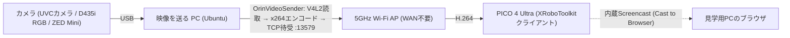

<!--
Notion から取得した本文をそのまま保存したもの（Notion-flavored Markdown。要約・編集なし）。
- 元ページ: PICO の映像（FPV）の設計と構築の手順（📚 モデル開発の文書 の 1 行・番号 MODEL-23）
- URL: https://app.notion.com/p/409194a1c5628177b1d8cb1b8368a34d
- 場所: Kota0 / Model & Control System Development Hub - モデル・制御システム開発ハブ / 📚 モデル開発の文書
- プロパティ: 状態=古い・種別=説明・読む順=4.9・最終確認日=2026-10-30
  正本=https://github.com/Orboh/doma-sorting-dev/blob/main/08-archive/openarm-vla-2610/openarm-pico-fpv-design-manual.md
- Notion の最終編集: 2026-10-30T14:11:26.392Z ／ 取得: 2026-10-31（Kota の PC の Claude Code・操作は Kento）
-->

<callout icon="📦" color="yellow_bg">
<b>アーカイブ（2026-10-30・更新しない）</b> 2026-10-16〜30 に急いで上げた OpenArm・VLA の手順書の凍結版。git の置き場は kota0-design-plan から [<code>Orboh/doma-sorting-dev</code>](https://github.com/Orboh/doma-sorting-dev/tree/main/08-archive/openarm-vla-2610)[ の ](https://github.com/Orboh/doma-sorting-dev/tree/main/08-archive/openarm-vla-2610)[<code>08-archive/openarm-vla-2610/</code>](https://github.com/Orboh/doma-sorting-dev/tree/main/08-archive/openarm-vla-2610) に移した。正本は Kento の Vault。ブランチ名・開始姿勢セットなどの事実は古くなりうるので、使う前に openarm-orboh の README で今の状態を確かめる。
</callout>

> <b>この文書について:</b> OpenArm の操作者が VR ゴーグル（PICO 4 Ultra）でカメラ映像を見ながら操作し、ゴーグルの視界を PC にも出力できるようにする設計と構築手順。機材リスト・PC 要件・コマンド・検証手順を、初めての人が再現できるところまで書く。対になる遠隔テレオペ（リーダーとフォロワーを別の部屋に分ける）の設計は <mention url="https://app.notion.com/p/409194a1c56281aeb580c9f4aeb794c7" />。2 つの要求（別室からの遠隔操作・VR ゴーグルの視界）を俯瞰する親の設計は <code>openarm-remote-vr-teleop-design</code>（Orboh 社内の文書。必要ならメンバーに聞く）。映像の経路の出所は G1 × PICO の実証（<code>2026-08-17-g1-hand-teleop-integration</code> §8。Orboh 社内の文書。必要ならメンバーに聞く）。

> <b>移した文書</b>: orboh-company-vault（Kento の作業場）から 2026-10-30 に移した。以後このフォルダが正本で、変更は PR で行う。移すときに、顧客との案件の話・接続先（IP・SSID）・社内のマシン名とパスを除いた。PICO のコントローラで腕を動かす段（下の段階計画の第 3 段）の開発を始めるにあたって、関わる人が原本を読めるようにした。

> <b>2026-10-30 時点の注</b>: 本文の「Thor」は、フォロワーとカメラをつないでいる計算機のこと。北九州には Thor が無く、別の PC が同じ役をする。ブランチの現行は <mention url="https://app.notion.com/p/3fc194a1c56281d2a8cfcf22b922d3f8" /> と openarm-orboh の README を見る。

---

## 1. 目的と到達点

- <b>できるようになること①</b>: OpenArm の作業空間を映すカメラの映像を、Wi-Fi 越しに PICO 4 Ultra へ低遅延で表示する（操作者はゴーグルを被ったまま腕を操作できる）
- <b>できるようになること②</b>: 操作者がゴーグル内で見ている画面を、同じ Wi-Fi 上の PC のブラウザにミラー表示する（見学者・記録用）
- 書くコードはほぼゼロ。OSS の既製ツールの構築と設定が中心で、G1 の頭部カメラ → PICO で 2026-08-17 に通しで確かめた経路を転用する（遅延対策の改修は Orboh の fork に入っている。§5 手順 1）

---

## 段階計画（三段＋準備半段・2026-08-24）

OpenArm × PICO の到達点を、次の順に積み上げる。各段が単独で見せられる価値を持ち、失敗したときの切り分けが常に 1 段分で済む順序（目 → 神経 → 手）。

| 段 | 内容 | 新しく増えるもの | 状態 |
| --- | --- | --- | --- |
| 第 1 段 | フォロワー側の計算機につないだ RealSense の映像を PICO へ流す（<b>本書 §5 の範囲</b>） | 映像の出口（目） | ✅ 実機で成立（2026-08-24） |
| 第 2 段 | leader と follower を別の部屋に分けた無線テレオペ（<mention url="https://app.notion.com/p/409194a1c56281aeb580c9f4aeb794c7" />） | 指令のネットワーク受信と、途絶時の安全系（神経） | ✅ 実機で成立（2026-08-24・RTT p50=14.2ms／p99=161.7ms・196Hz で 7 分・ホールドの発動なし） |
| 統合（第 1 段 × 第 2 段） | 操作者が PICO の映像を見ながらリーダーで遠隔操作し、フォロワーが掴む | 映像と遠隔の統合＝実演の形 | ✅ 実機で成立（2026-08-24・ボトルを掴んでカゴに入れた。体感のラグは小さい。drop=true の修正の前は、遅れが溜まって操作できなかった） |
| 第 2.5 段 | PICO のコントローラの姿勢を読み、IK を解き、<b>シミュレータ上の OpenArm</b> で追従を確かめる | IK・クラッチ方式（下記）・倍率の検証（実機のリスクなし） | 未着手 |
| 第 3 段 | PICO のコントローラで実機の OpenArm をテレオペする（操作室に PICO だけ持って行けばよくなる） | 入力の差し替え（手）。第 1 段の映像と第 2 段の受信・安全系は<b>そのまま使う</b> | 未着手 |

<b>第 1 段の注意</b>:

- データ収集（lerobot）と<b>同時に</b>カメラを使うときだけ、§7 の分配構成が要る（映像を流すだけなら要らない。lerobot は RealSense SDK でカメラを掴むので、SDK が掴んでいる間は sender が V4L2 で開けない）
- グラス to グラスの遅延（カメラの前の出来事がゴーグルに映るまで）を測る（§5 手順 8）。この数値が、第 3 段でコントローラによる精密な操作ができるかの予算を決める

<b>第 3 段の設計上の要点（先に決めておく・2026-08-24 の段階計画・Kento 承認。実装は未着手）</b>:

- 難所はネットワークではなく <b>IK と操作性</b>。コントローラは手首の 6 自由度の姿勢しか返さないので IK が要る（openarm-orboh の <code>ik/</code> に左腕の土台がある）。リーチの外・関節の限界・特異点の扱いを最初から入れる
- <b>クラッチ方式</b>（トリガーを握っている間だけ追従し、離すと手だけ動かして原点を合わせ直せる）を採用する予定。これが無いと、操作者の腕の可動域がロボットの可動域になり、疲れて精度が落ちる
- コントローラの入力を読むには <b>PC Service（§6）が要る</b>。また PICO の入力は <b>1 プロセスしか読めない</b>（G1 で実測。2 つのプロセスが読むと、後から読んだ方は黙って 0 を返す）ので、入力を読む処理は 1 プロセスにまとめる
- リーダーアームでの実演（データ収集の主力）は第 3 段の後も残し、置き換えるかはデータの質を測って決める

---

## 2. 全体構成



- 送信機 <b>OrinVideoSender</b> は、名前に反して<b>汎用の V4L2 → H.264 送信機</b>で、x86 の Ubuntu でも Jetson（aarch64）でも動く（GPU 不要・ソフトエンコード）。単眼カメラは自動で左右に複製して 2560x720 の SBS にする（2D 表示）。ZED のステレオなら <code>--sbs</code> で本当の立体視になる
- 接続の向きは <b>PICO 側から sender の IP:13579 へ取りに行く</b>（Listen 方式）。PC 側のファイアウォールで 13579 番の受信を許可しておく

### OrinVideoSender とは（初めての人はここから）

<b>公式</b>: [XR-Robotics/XRoboToolkit-Orin-Video-Sender](https://github.com/XR-Robotics/XRoboToolkit-Orin-Video-Sender)。<b>使うのは Orboh の fork</b>（§5 手順 1）。

- <b>何者か</b>: PICO のヘッドセットをロボットの遠隔操作に使うための OSS 群「XRoboToolkit」の、<b>PC 側の映像送信のコンポーネント</b>。PC につないだカメラの映像を H.264 に圧縮し、ネットワーク越しにヘッドセットへ配る小さなコマンドラインツール（C++・実行ファイル 1 個）
- <b>受信側とセット</b>: ゴーグル側で受けるのは同じ開発元の <b>XRoboToolkit-Unity-Client</b>（PICO のアプリ・§5 手順 2 で入れる）。この 2 つで送受信が完結する
- <b>名前の注意</b>: 「Orin」は NVIDIA Jetson Orin 向けに書かれた経緯の名残で、<b>普通の x86 の Ubuntu PC でもビルドして動く</b>（Jetson・GPU は不要）
- <b>できること</b>: Linux がカメラとして認識するデバイス（<code>/dev/videoX</code>）なら何でも入力にできる。単眼カメラは自動で左右に複製し、ゴーグル表示用の SBS（side-by-side・2560x720）を作る＝2D 表示。ステレオカメラ（ZED 等）は <code>--sbs</code> を付けるとそのまま流れて立体視になる

<b>主なオプション（本書で使うもの）</b>:

| オプション | 意味 |
| --- | --- |
| <code>--listen 0.0.0.0:13579</code> | ポート 13579 で待ち受け、ヘッドセットからの接続を待つ（本書の基本形） |
| <code>--device /dev/videoX</code> | 読み取るカメラのデバイス |
| <code>--sbs</code> | 入力がもともと左右並び（ステレオカメラ）だと宣言し、自動の複製を止める |
| <code>--preview</code> | PC の画面にも映像を出す（デバッグ用） |

<b>準備の全体像</b>: ① §5 手順 1 でビルド（<code>make</code> 一発）→ ② <code>./OrinVideoSender --help</code> が出れば準備完了 → ③ §5 手順 4 のテスト信号で「PC → ゴーグル」を通す。カメラもロボットも無い状態で③まで進められる。

> 根拠: XRoboToolkit-Orin-Video-Sender の README・Makefile「webcam ビルドは GStreamer＋ZMQ のみ・ZED/CUDA 不要」、<code>2026-08-17-g1-hand-teleop-integration</code> §8.1（Orboh 社内の文書）「sender は最初から汎用の V4L2 → H.264 変換器だった」

---

## 3. 機材リスト

| 機材 | 所有 | 備考 |
| --- | --- | --- |
| PICO 4 Ultra＋コントローラ | Orboh（2 台。2026-10 時点で 1 台は北九州、1 台は板橋） | 公式の対応表記は PICO 4／4 Pro だが、<b>4 Ultra での動作を 2026-07-28 に確かめた</b> |
| 5GHz の Wi-Fi ルーター | Orboh または任意 | <b>インターネット接続は不要</b>。PC と PICO を同じ LAN に置くためだけの箱 |
| カメラ | Orboh: D435i（RGB を使う）／ZED Mini／D405 | 任意の UVC カメラで代わりになる（市販の Web カメラでも動く）。立体視は ZED Mini だけ |
| 映像を送る PC | — | 要件は §4 |
| USB ケーブル類 | — | カメラの USB3 ケーブル。延長するならアクティブリピータを勧める |

---

## 4. 映像を送る PC の要件

| 項目 | 要件 | 根拠 |
| --- | --- | --- |
| OS | Ubuntu 22.04 / 24.04（x86\_64）、または Jetson（aarch64） | Orboh の開発 PC（Ubuntu 24.04 x86）と Thor でビルド・動作を確かめた |
| GPU | <b>不要</b> | x264 のソフトエンコード。実測の負荷は sender 約 30%＋GStreamer 約 20%（1 コア比）＝ノート PC で十分 |
| ネットワーク | 5GHz の Wi-Fi（または AP への有線） | 2.4GHz は工場などのノイズと干渉しやすい |
| 権限 | sudo（パッケージの導入・必要なら v4l2loopback） | — |
| インターネット | セットアップのときだけ要る（apt / git clone） | 運用は LAN だけで完結する |

---

## 5. 構築手順

### 手順 1: PC — 依存の導入と sender のビルド

```bash
sudo apt update
sudo apt install -y build-essential pkg-config git \
  libgstreamer1.0-dev libgstreamer-plugins-base1.0-dev \
  gstreamer1.0-plugins-base gstreamer1.0-plugins-good \
  gstreamer1.0-plugins-bad gstreamer1.0-plugins-ugly \
  gstreamer1.0-tools libzmq3-dev v4l-utils

# Orboh の fork の vector-x86 ブランチを使う（公式 repo の現行 main はビルドできない・下の注意を参照）
git clone -b vector-x86 https://github.com/Orboh/XRoboToolkit-Orin-Video-Sender.git
cd XRoboToolkit-Orin-Video-Sender
make
./OrinVideoSender --help   # ヘルプが出ればビルド成功
```

<callout icon="⚠️" color="red_bg">
<b>公式リポジトリの現行 main はビルドできない（2026-08-24 実測）→ Orboh の fork を使う（2026-08-27 確定）</b>

本書で使う <code>main_web_listen.cpp</code>（Listen 方式・PICO クライアント互換）と検証用の <code>fake_vr_client.py</code> は公式 repo の現行 main に無く、公式の Makefile の既定は ZED ビルド（ZED SDK 必須・<code>sl/Camera.hpp</code> のエラーで落ちる）。<b>public の fork </b><b><code>Orboh/XRoboToolkit-Orin-Video-Sender</code></b><b> の </b><b><code>vector-x86</code></b><b> ブランチが配布の正本</b>（差分の一覧は fork 内の PR #1）。
</callout>

- x264 エンコーダは <code>gstreamer1.0-plugins-ugly</code>（x264enc）に入っている。確認: <code>gst-inspect-1.0 x264enc</code>
- Makefile の既定が webcam ビルド（<code>main_web_listen.cpp</code>）なので編集は要らない。ZED SDK・CUDA も要らない
- できるのはリポジトリ直下の実行ファイル <code>OrinVideoSender</code> 1 個。インストールは要らず、その場で <code>./OrinVideoSender</code> で動かす

### 手順 2: PICO — 開発者モードとクライアントの APK（adb 不要）

1. PICO の電源を入れて初期設定をする（<b>初期設定のときだけインターネットが要る</b>。以後は要らない）
2. <b>開発者モードを有効にする</b>: 設定 → 左のメニューの最下部「Developer」（無ければ「Software」を連打すると出る）
3. 設定 → Developer → <b>Safeguard をオフ</b>
4. <b>APK は PICO の内蔵ブラウザで直接落とす</b>: <code>github.com/XR-Robotics</code> → <code>XRoboToolkit-Unity-Client</code> の Releases → <code>XRoboToolkit-PICO-1.1.1.apk</code>
5. <b>File Manager アプリ → 左欄「APKs」→ 落とした APK を選ぶ → Install</b>（PICO 4 Ultra で実績のある経路・2026-07-28）
6. アプリはライブラリの <b>Unknown</b> の欄に入る

### 手順 3: ネットワーク

1. PC と PICO を<b>同じ 5GHz の Wi-Fi</b> に入れる（WAN の無い単独の AP でよい）
2. PC の IP を確かめて控える: <code>ip -4 -brief addr show</code>（Wi-Fi のインタフェースの IPv4）
3. <b>DHCP なので IP は接続のたびに変わりうる</b>。セッションを始めるたびに取り直して PICO に入れ直す
4. ファイアウォールが有効なら TCP 13579 を許可する: <code>sudo ufw allow 13579/tcp</code>（ufw を使っている場合）

### 手順 4: 通しの確認（カメラ・ロボット不要のテスト信号）

実カメラをつなぐ前に、テスト映像で「PC → PICO の表示」の下流だけを確かめる。仮想カメラに SMPTE のカラーバーを流し込み、sender に読ませる:

```bash
sudo apt install -y v4l2loopback-dkms
sudo modprobe v4l2loopback video_nr=10 card_label=TestCam exclusive_caps=1

# 端末 1: テスト信号を /dev/video10 へ
gst-launch-1.0 -q videotestsrc pattern=smpte is-live=true \
  ! video/x-raw,format=YUY2,width=1280,height=720,framerate=30/1 \
  ! identity drop-allocation=true ! v4l2sink device=/dev/video10 sync=false

# 端末 2: sender を起動（TCP 13579 で待ち受け）
./OrinVideoSender --listen 0.0.0.0:13579 --device /dev/video10
```

ヘッドセットを使わない一次確認には、同梱の <code>fake_vr_client.py</code>（PICO のふりをするクライアント）も使える（2026-08-17 の fps の実測で使った）。

### 手順 5: PICO で表示

1. PICO で XRoboToolkit のアプリを起動する
2. <b>Remote Vision（カメラのパネル）→ ソース「ZEDMINI」を選ぶ →「Listen」→ camera source ip に PC の IP を入れる（ポート 13579）→ Confirm</b>
3. テスト信号（カラーバー）がゴーグルに出れば下流は全部通っている
4. 表示の切り替えは右手の <b>B</b> ボタン（side-by-side ⇄ stereo-3D）。単眼のソースは 2D の表示になる

> 補足: ソース名が「ZEDMINI」でも、中身は「sender が送る H.264 を受けるモード」なので、<b>ZED 以外のカメラでもこれを選べばよい</b>（G1 の単眼カメラで確かめた）

### 手順 6: 実カメラをつなぐ

```bash
# つながっているカメラのノード名の一覧
for d in /sys/class/video4linux/video*/name; do echo "$d: $(cat $d)"; done
# フォーマットの確認（YUY2/MJPG が読めるノードを使う）
v4l2-ctl -d /dev/videoX --list-formats-ext | head -30
```

- <b>普通の UVC カメラ</b>: 該当のノードを <code>--device</code> に指定するだけ
- <b>D435i の RGB を使うとき</b>: RealSense はノードを複数つくる。上のコマンドで RGB のノードを見つけて指定する（深度・IR のノードは使わない）
- <b>ZED Mini（立体視）</b>: <code>ZED-M</code> と出る若い方の番号を指定し、<b><code>--sbs</code></b><b> を付ける</b>（デバイス自体が左右並びで出すので、複製を止めるフラグ）

```bash
# 単眼カメラの例
./OrinVideoSender --listen 0.0.0.0:13579 --device /dev/video4
# ZED Mini（立体視）の例
./OrinVideoSender --listen 0.0.0.0:13579 --device /dev/video4 --sbs
```

- <b>エンコーダは既定の x264（zerolatency）が本番</b>。<code>--nvenc</code>（Jetson のハードエンコード）は <b>A/B で測って採用を見送った</b>（2026-08-27）。動きはするが<b>腕を動かした瞬間だけラグが悪化し</b>（止まっているときは軽い）、x264 に戻すと「かなりリアルタイム」に戻った。動きでフレームが大きくなった瞬間の、送り出しの山の差とみている（x264 zerolatency は VBV を厳しく絞る）。NVENC にもう一度挑むなら <code>vbv-size</code> を絞るところから
- <b>起動はスクリプトに焼き込む</b>: 手で打ったときに折り返しで <code>--device</code> が抜け、既定の <code>/dev/video0</code>（RealSense では<b>深度のノード Z16</b>）を掴んで毎回パイプラインが死ぬ事故が実際に起きた（2026-08-27）。フォロワー側の計算機には、正しい引数を焼き込んだ起動スクリプト（x264 版）を置いて使っていた

### 手順 7: ゴーグルの視界を PC にミラーする

<b>本線: PICO 内蔵のスクリーンキャスト（追加の開発なし）</b>

1. PICO のクイック設定（時刻・電池・Wi-Fi の表示部をクリック）→ <b>Screencast</b>
2. <b>「Cast to Browser」</b> を選ぶ → 出た URL を<b>同じ Wi-Fi 上の PC のブラウザ</b>で開く
3. 「Start Screencast」→ ヘッドセット側で「Allow」

- ✅ <b>実機で確かめた（2026-08-24・PICO 4 Ultra）</b>: URL の形は <b><code>http://<PICOのIP>:3342/cast</code></b>（IP は DHCP で変わるので PICO の WLAN の詳細で取り直す）。<b>PICO 自身が LAN 内の Web サーバとして配る形</b>なので、ブラウザ側はこの URL を開くだけでよい。初回は「ネットワーク未接続」のエラーが出たが、PICO 側の設定変更で直った（どの設定だったかは記録が無い・分かったらここに足す）
- 補足: キャストは見学者用の枝で、操作のループには入らない。キャストのラグが大きいときは代替 2 へ
- 代替 1: <b>scrcpy</b>（PICO は Android で開発者モードが有効なので、adb でつないで低遅延のミラー・録画ができる）
- 代替 2: 映像のソースを分けて PC 側でも表示する（ヘッドセットの負荷はゼロだが、操作者の UI・首振りは映らない）

### 手順 8: 遅延の確認（デモの設計の前提）

1. <b>一次判定は操作者の体感でよい</b>: カメラの前で手を振り、ゴーグル内の追従を見る。「ほぼ同時」なら精密な作業を含むデモの設計に進める。<b>2026-08-24 の実機では体感ほぼ同時（ずれてもコンマ数秒未満）</b>
2. <b>数値が要るときはキャストを併用する</b>: PC の画面にミリ秒のストップウォッチを出す → カメラでその PC の画面を撮る → ゴーグルの視界を手順 7 の Cast to Browser で PC へミラーする → <b>同じ PC の画面に「元のストップウォッチ」と「ミラーの中のストップウォッチ」が並ぶので、スクリーンショット 1 枚で差が読める</b>。キャストの遅延が上乗せされるので、<b>実際の遅延の上限</b>として扱う
3. 目安: 300ms を超えるなら精密な作業は避け、ピック＆プレース級に留める
4. ※「ゴーグル内の表示と実物を 1 枚の写真に収める」方法は、<b>被ったままでは撮れないので使わない</b>（2026-08-24 に現場で棄却）

---

## 6. XRoboToolkit PC Service について（要るか要らないか）

G1 のテレオペでは、PC 側に <b>PC Service（RoboticsServiceProcess）</b> を常駐させていた（コントローラの入力を取るため）。<b>カメラの表示だけなら PC Service は要らないと実機で確かめた</b>（2026-08-24・PC Service がどこにも動いていない状態で PICO の表示が成立）。

- PICO のコントローラで OpenArm を操作する段（段階計画の第 3 段）では、入力を取るために要る
- 起動のしかた（付属の <code>run2D.sh</code> は GUI 側が壊れていて使えないので本体を直接起動する）と、入力を読む Python の <code>xrobotoolkit_sdk</code> の使い方は、<code>sonic-pico-teleop-setup-manual</code> 手順 0（Orboh 社内の文書。必要ならメンバーに聞く）にある

---

## 7. データ収集と同時に使う場合

同じカメラを収集（lerobot record）と sender の両方が読むと、<b>後から開いた側が「Device or resource busy」で弾かれる</b>。同時に使うときの正本は <b>openarm-orboh の </b><b><code>scripts/start-collection-cameras.sh</code></b>（2026-08-27 新設・ヘッドレスで通して 29.7fps を確かめた）:

- 実カメラ 2 台（chest D435i＋wrist D405）を仮想カメラ 3 本に分ける: <code>/dev/video20</code>＝<b>PICO 用の合成（1280x720: chest の 4:3 を中央 960x720 に全面で置き、wrist の小窓（既定 216x162・</b><b><code>WRIST_W/H</code></b><b> で上書き可）を chest の右下に内側 16px で重ねる PiP）</b>／<code>/dev/video21</code>・<code>22</code>＝素の chest・wrist（record 用）。レイアウトの変遷: PiP（8/27）→ 右に 2 枚並べる（8/28・市松模様の根絶）→ <b>中央の安全域の PiP（8/31・現行）</b>
- <b>レイアウトの設計判断（2026-08-31・ステレオの刈り込みへの対応）</b>: PICO のステレオ表示は、送ったフレーム 1280x720 のうち<b>中央の約 4:3（左右それぞれ約 160px を刈る）しか描かない</b>（スクリーンショットで実測。トリガーで切り替える平面＝二画面のモードでは全幅が見える＝送ったフレームは欠けておらず、ステレオ化だけが左右対称に欠ける）。見える範囲が 4:3 で chest も 4:3 なので、<b>chest を全面で出すと見える範囲がちょうど埋まり、wrist を重ならずに置く場所は幾何的に無い</b>。重ならないようにするには chest を 672x504 以下へ縮めるしかなく（主な視界の面積が半分）割に合わないので、wrist の小窓を chest の右下に重ねる形を採った（Kento 承認・2026-09-01）。重なりは<b>操作者の視界だけの話で、記録するデータ（video21/22 の素の映像）には影響しない</b>。調整のつまみ: 刈り込み幅の個体差は <code>MARGIN_LR</code>（既定 160）、小窓の大きさは <code>WRIST_W/H</code>（<b>既定 216x162＝chest の約 5%</b>。288x216 だと約 9%。位置＝角の変更はスクリプト内の <code>WRIST_X/Y</code>）
- 起動の順: <code>start-collection-cameras.sh</code> → sender <code>--device /dev/video20</code> → record に <code>CHEST_V4L2=/dev/video21 WRIST_V4L2=/dev/video22</code>。<b>操作者が PICO で見る映像＝記録される chest の映像</b>（＋wrist の小窓）
- 上書きで再起動してよい（起動時に前のものを自動で片付ける）。実装に焼き込んだ罠 5 件（gst で複数の v4l2src と compositor を同居させると SIGSEGV → 合成は ffmpeg／exclusive\_caps の Output のラッチ → 毎回モジュールを読み直す／ffmpeg はフォーマット未設定の loopback に書けない → gst で 1 フレーム種をまく／pipefail の下の <code>lsmod | grep -q</code> は偽陰性 → <code>/proc/modules</code> を直接読む／固まった書き手は TERM で止まらない → <code>fuser -k -9</code>）は、スクリプトのコメントと commit <code>31f69ce</code> を見る
- ⚠ 仮想カメラの番号に 10 番台を使わない（D405 の実ノードが video6〜11 を使う）

---

## 8. トラブルシュート

| 症状 | 原因の候補 | 対処 |
| --- | --- | --- |
| PICO に映像が出ない | IP の間違い（DHCP で変わった）／別のセグメント／ファイアウォール | <code>ip -4 -brief addr show</code> で取り直して PICO に入れ直す。<code>ping <PICOのIP></code> で同じ LAN か確かめる。TCP 13579 を許可する |
| sender が起動しない | GStreamer のプラグイン不足 | <code>gst-inspect-1.0 x264enc</code> で確かめる。無ければ plugins-ugly を入れる |
| 映像がカクつく | 2.4GHz で接続している／帯域の取り合い | 5GHz に固定・専用の SSID。ビットレートの実測の参考値は §9 |
| <b>ラグが時間とともに増えて戻らない</b> | 古い版の sender。①フレームを捨てない＝エンコード前の停滞がそのまま遅延になる ②送った後の TCP の経路の在庫（送信バッファ → Wi-Fi → 受信バッファ → デコード待ち）は <code>drop=true</code> でも消えず、一瞬の詰まりが消えない遅延に変わる（TCP は受け取ったバイトを捨てられない＋PICO は全フレームを再生する＝列が縮まない） | <b>fork の版で二重に直してある</b>: <code>drop=true</code>（2026-08-24・①の根絶）＋<b>SIOCOUTQ の backpressure</b>（2026-08-31・②の根治: 相手の受け取り確認が無い在庫が 192KB を超えたら送るのを止める → 在庫が掃ける → 32KB 未満になったら IDR を強制して再開。消えない遅延が「1 秒未満止まって最新に追いつく」に変わる。実機で溜まらないこと・Listen し直しが要らないことを確かめた 2026-09-01）。fork の <code>vector-x86</code> の最新でビルドし直す |
| <b>腕を動かした瞬間だけラグが悪化する</b>（止まっているときは軽い） | <code>--nvenc</code> を使っている＝動きでフレームが大きくなり送り出しが山になる | <b>既定の x264 に戻す</b>（2026-08-27 の A/B 実測で解消） |
| <b>映像の右端に白黒の市松模様</b> | sender の compositor の既定の背景が余白に符号化される（16:9 未満の入力を縦横比を保って嵌めた隙間・送ったフレームのダンプで確定） | <b>fork の最新で解消済み</b>（<code>background=black</code>・2026-08-28）。分配側も 16:9 の合成にしたので余白自体が出ない |
| <b>ステレオ表示にすると画面の左右が欠ける</b>（平面＝二画面のモードなら全部見える） | PICO のステレオ描画の仕様＝1280x720 のうち中央の約 4:3 しか出さない（左右それぞれ約 160px を刈る） | <b>分配側の中央の安全域のレイアウトで解消済み</b>（2026-08-31 実装・09-01 実機確認・§7 の設計判断）。まだ欠ける個体は <code>MARGIN_LR=180</code> などで広げて再起動する |
| <b>映像が固まった／PICO から繋ぎ直せない</b> | 古い版の sender の切断ハング（相手が黙って消えると accept が止まる・2026-08-25 に発見） | <b>fork の版で修正済み</b>（keepalive で約 25 秒後に自動で戻る・2026-08-27）。古い版は sender の再起動で戻る |
| デバイスが開けない | 他のプロセスがカメラを使っている | <code>fuser /dev/videoX</code> で見つけて止める。または §7 の分配構成にする |
| PICO のアプリで接続できない | APK の版 | v1.1.1 で実績あり。他の版は [Releases の一覧](https://github.com/XR-Robotics/XRoboToolkit-Unity-Client/releases) で切り分ける |
| カラーバーは映るが実カメラが映らない | ノードの選び間違い／フォーマットが合わない | §5 手順 6 のノードの一覧とフォーマットの確認をやり直す |

---

## 9. 実測の参考値（G1 の構成・2026-08-17・x86 の開発 PC）

| 項目 | 実測 |
| --- | --- |
| sender → クライアント | 29.0 fps・3.90 Mbps（30 秒連続） |
| H.264 の出力 | 2560x720 SBS・Annex-B |
| CPU の負荷 | sender 約 30%＋GStreamer 約 20%（1 コア比） |
| 制御との同時運用 | 全身制御の DDS の受信レートは落ちなかった（p99 の遅延 +0.24ms） |

<b>OpenArm の構成での実測（2026-08-24・Thor＝Jetson aarch64・D435i </b><b><code>/dev/video4</code></b><b> 直読・疑似クライアントで 8 秒）</b>: 29.4fps・4.00Mbps・Annex-B の先頭 <code>00000001</code> を確認・CLOSE\_CAMERA で正常に切断。G1 の構成と同じ水準。

---

## ラグの現在地と改善の余地（2026-09-01 時点・次にラグを改善するときはここから）

<b>到達点</b>: 両腕の遠隔テレオペと PICO FPV の同時運用で「かなりリアルタイム」（2026-08-27・操作者の体感）。ボトルを掴んでカゴに入れることに成功（8/24）。<b>遅れが溜まる問題は根治した</b>（2026-09-01 の実機確認: backpressure を入れた後は、Listen し直さなくてもラグが溜まらないことを操作者が確かめた。以前の「ラグを感じたら Listen し直す」運用は原則いらない）。<b>グラス to グラスの数値の基準はまだ測っていない</b>（体感でコンマ数秒未満）。次に改善するときは、最初に §5 手順 8 のキャスト併用法で 1 回測って数値を残す（数値が無いと改善の効果を比べられない）。

<b>今の構成（＝この基準を崩さない）</b>:

- 経路: D435i の RGB（<code>/dev/video4</code>）→ フォロワー側の計算機の sender（<b>x264 zerolatency・4Mbps</b>）→ 5GHz の Wi-Fi → PICO 4 Ultra。計算機も PICO も無線＝<b>電波 2 ホップ</b>
- 入れてある対策 5 つ: ①フレームを捨てる <code>drop=true</code>（8/24・エンコード前の蓄積の根絶）②TCP\_NODELAY（8/27・Nagle の待ちを除く）③keepalive＋送信 3 秒のタイムアウト＋backlog=4（8/27・切断ハングの根治）④エンコーダ＝x264 で確定（8/27・NVENC は動かしたときの山でラグが悪化 → A/B で棄却）⑤<b>SIOCOUTQ の backpressure</b>（8/31・<b>送った後の TCP の経路の在庫が消えない遅延になるのを根治</b>: 受け取り確認が無い在庫が <code>--outq-high-kb</code>（既定 192KB≒4Mbps で約 400ms）を超えたら送るのを止める → 受信側が在庫を消化する → <code>--outq-low-kb</code>（既定 32KB）未満になったら IDR を強制して再開。消えない遅延が「1 秒未満止まって最新に追いつく」に変わる。在庫が 5 秒進まなければ相手が死んだとみなす。0 を指定すると無効。疑似的に止めた試験に合格＝再開の最初のフレームが SPS＋PPS＋IDR で映像が崩れない、実機で蓄積が消えたことを確かめた 9/1）
- ソースの正本: fork <code>Orboh/XRoboToolkit-Orin-Video-Sender</code> の <code>vector-x86</code>

<b>残っている遅延の内訳（推定）</b>: カメラ 33ms（30fps）＋エンコード数 ms＋無線 2 ホップの伝送とジッタ＋PICO のデコードと表示 ＝ 合計 100〜200ms 級。混んだ瞬間は、フレームを捨てる処理と backpressure の副作用で 1 秒未満の乱れ・止まりが出る（ラグは溜まらない）。

<b>改善の余地（効きそうな順・1〜6 は未着手）</b>:

1. <b>フォロワー側の計算機を有線にする（本命）</b>: 計算機の RJ45 とルーターの LAN ポートをケーブル 1 本でつなぐ。無線のホップが半分になり、映像のジッタとテレオペの p99 の山（161.7ms）の両方に効く。注意＝有線の新しい IP を PICO に入れ直す
2. <b>ビットレートを 4 → 2Mbps にする</b>: 混雑への余裕が倍になる。sender 側で強制する小さな修正か、クライアントが求める値を変える
3. <b>専用の AP に分ける</b>: 他の機器との帯域の取り合いを断つ
4. <b>60fps にする</b>: D435i は低い解像度なら 60fps が出る＝各段の「1 フレーム待ち」が全部半分になる。解像度とのトレードオフ
5. <b>見学者のミラーを ZMQ の枝にする</b>: キャスト（PICO 経由）をやめ、sender から直接 PC へ 2 本目を流す。<b><code>--zmq</code></b><b> は README に書いてあるだけで今の実装に無い＝実装が要る</b>（8/27 確認）
6. <b>NVENC にもう一度挑む</b>: <code>vbv-size</code> を絞るところから。動かしたときの山の問題が解ければ CPU が空く
7. <b>大工事: TCP → UDP／WebRTC</b>: 「受信側が古いデータを捨てられる」転送に置き換える。⑤の backpressure が送信側でこの利点の大半（消えない遅延の防止）を先取りしているので、残る価値は「止まる代わりに画質で吸収する」適応ビットレート。手を付けるなら受信の選択肢は 3 つ: (a) PICO の内蔵ブラウザ＝WebRTC 対応なので MediaMTX などを立てるだけ（アプリの開発なし・平面表示・最安の PoC）(b) WebXR のページ（ブラウザのままステレオ表示・レイアウトは全部自作）(c) Unity のクライアントの改造（com.unity.webrtc・最大の工数）。a → b の順に測ってから c を決める

<b>未確認 1 件</b>: スリープ → Listen し直すだけで自動で戻るか（③の keepalive の修正の現場確認・約 25 秒で戻るはず）。

---

## 10. 検証状態の表

| 項目 | 状態 | 出所 |
| --- | --- | --- |
| sender の x86 でのビルド・動作 | ✅ 確認済み（Ubuntu 24.04） | 2026-08-17 |
| sender の aarch64（Jetson Thor）でのビルド・動作 | ✅ 確認済み（依存は GStreamer＋ZMQ だけ・apt の追加なし） | 2026-08-24 |
| <b>D435i の RGB のノードを sender で直読</b> | ✅ 確認済み（<code>/dev/video4</code> YUYV 直読・29.4fps・4.00Mbps・Annex-B） | 2026-08-24（<code>fake_vr_client.py</code>） |
| 単眼カメラ → PICO 表示（SBS の自動複製） | ✅ 確認済み（G1 の頭部カメラ） | 2026-08-17 |
| ZED Mini の立体視（<code>--sbs</code>・B で切り替え） | ✅ 確認済み | <code>sonic-pico-teleop-setup-manual</code>（Orboh 社内の文書） |
| PICO 4 Ultra での APK 導入・接続 | ✅ 確認済み（v1.1.1） | 2026-07-28 |
| <b>D435i の映像の PICO 実機表示</b> | ✅ 確認済み（Remote Vision → ZEDMINI → Listen） | 2026-08-24 |
| <b>Cast to Browser の PC ミラー</b> | ✅ 実機で成立（URL の形 <code>http://<PICOのIP>:3342/cast</code>・LAN 内で完結） | 2026-08-24 |
| <b>カメラの表示だけのときの PC Service の要否</b> | ✅ <b>不要と確定</b>（PC Service がどこにも動いていない状態で表示が成立） | 2026-08-24 |
| グラス to グラスの遅延 | ✅ 体感ほぼ同時（ずれてもコンマ数秒未満・操作者の観察）。数値は §5 手順 8 のキャスト併用法で | 2026-08-24 |
| <b>Orboh が手を入れたソースの配布経路</b> | ✅ public の fork <code>Orboh/XRoboToolkit-Orin-Video-Sender</code>（<code>vector-x86</code> ブランチ・差分の一覧は fork 内の PR #1） | 2026-08-27 |
| <b>NVENC（</b><b><code>--nvenc</code></b><b>）</b> | ⚠ 動くが<b>採用を見送り</b>＝腕の動きに連動してラグが悪化・x264 に戻すと解消（A/B 実測）。JetPack 7 の指定は <code>preset-id</code>／<code>tuning-info-id</code>（<code>maxperf-enable</code> は廃止） | 2026-08-27 |
| <b>切断ハングの恒久修正（keepalive＋送信タイムアウト＋backlog=4）</b> | ✅ 実装して fork に反映（現場での再現確認は次の PICO のセッションで） | 2026-08-27 |
| <b>TCP\_NODELAY（Nagle の無効化）</b> | ✅ 実装して fork に反映（映像・制御の両方のソケット） | 2026-08-27 |
| <b>蓄積ラグの backpressure による根治（SIOCOUTQ・commit </b><b><code>cf2613d</code></b><b>）</b> | ✅ 実装＋疑似的に止めた試験に合格（4 秒止めて 101 フレームを飛ばし IDR から再開・映像の崩れなし）＋<b>実機のテレオペで蓄積が消え、Listen し直しが要らないことを確認</b> | 2026-08-31 実装・2026-09-01 実機確認 |
| <b>ステレオ表示の刈り込みへの対応（中央の安全域のレイアウト）</b> | ✅ 実機で確認（ステレオで欠けない・wrist の小窓は chest の右下に重ねる＝§7 の設計判断） | 2026-09-01 |
| <b>PICO のコントローラによる操作（第 3 段）</b> | ⬜ 未着手 | — |

---

## 根拠ソース一覧

| ソース | パス |
| --- | --- |
| sender の本体とビルド構成 | [XR-Robotics/XRoboToolkit-Orin-Video-Sender](https://github.com/XR-Robotics/XRoboToolkit-Orin-Video-Sender)（README・Makefile）、Orboh の fork の <code>vector-x86</code> と fork 内 PR #1 |
| G1 → PICO の通しの検証・実測値 | <code>2026-08-17-g1-hand-teleop-integration</code> §8（Orboh 社内の文書） |
| PICO の APK の導入・4 Ultra の実績・ZED の手順・PC Service | <code>sonic-pico-teleop-setup-manual</code>（Orboh 社内の文書） |
| PICO のクライアントの APK | [XR-Robotics/XRoboToolkit-Unity-Client Releases](https://github.com/XR-Robotics/XRoboToolkit-Unity-Client/releases) |
| PC へのミラーの手順（二次） | [VR Expert KB](https://knowledge.vr-expert.com/kb/how-to-screencast-with-the-pico-4-enterprise/)・[PICO 公式 blog](https://www.picoxr.com/global/blog/how-to-activate-screencast-with-pico4)（公式は取得できなかった・実機と照合した） |
| 収集と同時に使うときの分配 | openarm-orboh <code>scripts/start-collection-cameras.sh</code>（commit <code>31f69ce</code>） |
| 遠隔テレオペの設計（対になる文書） | <mention url="https://app.notion.com/p/409194a1c56281aeb580c9f4aeb794c7" /> |
