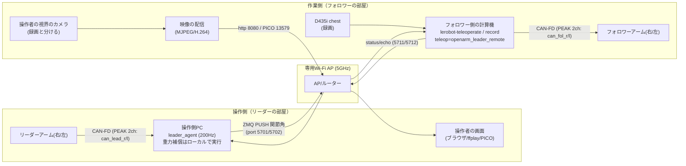

<!--
Notion から取得した本文をそのまま保存したもの（Notion-flavored Markdown。要約・編集なし）。
- 元ページ: 別室遠隔テレオペの設計（受け口・途切れたときの安全・初回のセットアップ）（📚 モデル開発の文書 の 1 行・番号 MODEL-24）
- URL: https://app.notion.com/p/409194a1c56281aeb580c9f4aeb794c7
- 場所: Kota0 / Model & Control System Development Hub - モデル・制御システム開発ハブ / 📚 モデル開発の文書
- プロパティ: 状態=古い・種別=説明・読む順=4.95・最終確認日=2026-10-30
  正本=https://github.com/Orboh/doma-sorting-dev/blob/main/08-archive/openarm-vla-2610/openarm-remote-teleop-design.md
- Notion の最終編集: 2026-10-30T14:11:27.232Z ／ 取得: 2026-10-31（Kota の PC の Claude Code・操作は Kento）
-->

<callout icon="📦" color="yellow_bg">
<b>アーカイブ（2026-10-30・更新しない）</b> 2026-10-16〜30 に急いで上げた OpenArm・VLA の手順書の凍結版。git の置き場は kota0-design-plan から [<code>Orboh/doma-sorting-dev</code>](https://github.com/Orboh/doma-sorting-dev/tree/main/08-archive/openarm-vla-2610)[ の ](https://github.com/Orboh/doma-sorting-dev/tree/main/08-archive/openarm-vla-2610)[<code>08-archive/openarm-vla-2610/</code>](https://github.com/Orboh/doma-sorting-dev/tree/main/08-archive/openarm-vla-2610) に移した。正本は Kento の Vault。ブランチ名・開始姿勢セットなどの事実は古くなりうるので、使う前に openarm-orboh の README で今の状態を確かめる。
</callout>

> <b>この文書について:</b> OpenArm のリーダー/フォロワーのテレオペを「操作側（リーダーの部屋）」と「作業側（フォロワー＋計算機）」の 2 部屋に分け、無線 LAN 越しに操作するシステムの設計書。設計判断・実装仕様・初回セットアップ・試験計画を 1 冊に収める。VR ゴーグルの表示は本書の対象外で、§9 で映像との境目だけを決める（ゴーグル側の設計と構築は <mention url="https://app.notion.com/p/409194a1c5628177b1d8cb1b8368a34d" />）。

> <b>移した文書</b>: orboh-company-vault（Kento の作業場）から 2026-10-30 に移した。以後このフォルダが正本で、変更は PR で行う。移すときに、顧客との案件の話・接続先（実際の IP・SSID・ホスト名）・社内のマシン名とパスを除いた。PICO のコントローラで腕を動かす開発（フォロワー側の受け口 <code>openarm_leader_remote</code> をそのまま使う）を始めるにあたって、関わる人が原本を読めるようにした。

> <b>2026-10-30 時点の注</b>: (1) 本文の「Thor」は、フォロワーとカメラをつないでいる計算機のこと。北九州には Thor が無く、別の PC が同じ役をする。(2) ブランチの現行は openarm-orboh <code>dev/openarm-vla</code>・lerobot <code>feat/bi-openarm-soft-move-to</code> で、どちらにも本書の実装（<code>openarm_leader_remote</code>・<code>leader_agent</code>・起動スクリプト）が入っている。§4.4・§6.2 の <code>feat/openarm-remote-teleop</code> は 2026-08 当時のブランチ。(3) 開始姿勢は <code>config/initial_pose_*.yaml</code> から「開始姿勢セット」（<code>config/pose_sets/</code>）に替わった（<mention url="https://app.notion.com/p/3fe194a1c56281fe87aff7e768355a01" />）。起動スクリプトはセットを読む。

<b>要求の出所（2026-08-17 の相談）</b>:

- ① OpenArm を別の部屋から遠隔（無線）で操作したい（ある部屋で操作し、別の部屋で物を掴む）
- ② VR ゴーグルでカメラの映像を見ながら操作したい（ゴーグルの画面を PC にも出したい）→ <b>別の設計・本書は §9 の映像との境目だけ</b>

---

## 0. 前提・スコープ

| 項目 | 前提 |
| --- | --- |
| 対象システム | OpenArm のバイマニュアル（リーダー 2 本＋フォロワー 2 本）＋フォロワー側の計算機＋lerobot fork（Orboh/lerobot） |
| 操作側の PC | リーダーをつなぐ Linux の PC。開発機を兼ねてよい |
| ネットワークの範囲 | 同じ建物・専用 Wi-Fi AP の LAN の中（インターネット越し・拠点間は対象外。将来の拡張は §10） |
| 段階 | 右腕（単腕）で成立させてから左腕を足す（バイマニュアルは設計上カバー・§4.2） |
| データ収集 | 遠隔にしても、フォロワー側の録画と HF への push のパイプラインは<b>変えない</b>（§2 の案 A の分け方による） |

---

## 1. 現行の構成と「切る場所」

遠隔化の前は、Thor 1 台にリーダーとフォロワーの各腕が CAN-FD（PEAK の USB アダプタ・4ch）で直結し、lerobot の 1 プロセスが「リーダーの関節角を読む → 重力補償のトルクをリーダーへ返す → 同じ関節角をフォロワーへ送る（＋録画）」を 1 つのループで回していた。ネットワークを挟める切れ目はループの中に 1 か所しかない：<b>「リーダーを読む」と「フォロワーへ送る」の間</b>。ここを流れるのは関節角 8 個（float、バイマニュアルでも 16 個）だけで、毎秒数 KB。無線化のボトルネックにはならない。つまり<b>①は技術的に確実にできる</b>ので、論点は「どの層で切るか」と安全の設計に絞られる。

> 根拠: openarm-orboh <code>scripts/run_teleop_right.sh</code>「lerobot-teleoperate --robot.type=openarm\_follower --teleop.type=openarm\_leader --fps=200・重力補償＋vel FF」、<code>scripts/canup.sh</code>（L9-11）「44444444 = Leader アダプタ / 22222222 = Follower アダプタ・dev\_id 0x0=右/0x1=左」

補足（当時の実測値・実装の事実）:

- テレオペのループは <b>200Hz</b>（<code>--fps=200</code>）。リーダーの重力補償は <code>get_action()</code> の中で「q を読む → G(q) を計算 → MIT トルクを注入」が一体になっており、<b>リーダーがつながったホストのローカルのループで完結する</b>（＝分けてもネットワークを跨がない）。
- action の中身は <code>joint_1.pos</code>〜<code>joint_7.pos</code>＋<code>gripper.pos</code>（度の float）。<code>use_velocity_and_torque=true</code> のときは各モータに <code>.vel</code>/<code>.torque</code> が加わる（8 → 24 値）。
- PEAK のアダプタは<b>リーダー用 1 台（2ch）とフォロワー用 1 台（2ch）に物理的に分かれている</b>（channel\_id の焼き込み・USB ポートに依らない固定名 <code>can_lead_r/l</code>, <code>can_fol_r/l</code>）。<b>リーダーのアダプタごと操作側の PC へ移せる</b>。

> 根拠: lerobot fork <code>src/lerobot/teleoperators/openarm_leader/openarm_leader.py</code>（L479-488）「gravity\_compensation 時は \_inject\_gravity() が read と注入を融合」「action\_dict\[f"\{motor\}.pos"\]…use\_velocity\_and\_torque で .vel/.torque 追加」、openarm-orboh <code>scripts/canup.sh</code>（L16-21）

---

## 2. 構成案の比較と推奨

- <b>案 A（推奨）: アプリの層で分ける（LeKiwi 型）</b> — lerobot 本体に前例がある。LeKiwi（移動ロボット）が「操作者の PC＝リーダーをつなぐ、ロボット側＝ZMQ で action を受ける・指令が途切れたら watchdog で止める」というまさにこの構成を実装している（<code>lekiwi_host.py</code>。ZMQ PUSH/PULL・CONFLATE=1 で常に最新の値だけ・watchdog のタイムアウトで安全に止める）。これを雛形に OpenArm 版を書く。
- 案 B: CAN のトンネル（cannelloni などで CAN フレームごと無線で送る） — ソフトを変えなくてよいのが魅力だが、リーダーの重力補償のトルクのループ（高いレート・ジッタに弱い）がネットワークを跨ぐので危ない。採らない。
- 案 C: ROS2/DDS（enactic の openarm\_ros2） — スタックが今の LeRobot 系と別物になり、重力補償の fork や録画のパイプラインの資産を捨てることになる。DDS のマルチキャストは無線ルーターを越えるときに既知の罠もある（AVP のテレオペで経験済み）。採らない。

> 根拠: lerobot fork <code>src/lerobot/robots/lekiwi/lekiwi_host.py</code>（L42-48）「zmq.PULL + CONFLATE=1 で bind」（L93-98）「watchdog\_timeout\_ms 超過で stop」

<b>案 A の分け方の向き（重要）</b>: 「リーダー側だけを遠くへ出す」。録画のループ・カメラ・HF への push はフォロワー側に残す。

- 利点 1: データセットの質と収集のパイプラインが全く変わらない（カメラの画像はネットワークを通らない）
- 利点 2: ネットワークに載るのは関節角の dict だけ（200Hz でも 100KB/s 程度）
- 利点 3: 操作者が見る映像を録画と独立に設計でき、②（VR ゴーグル）とゆるくつながる

---

## 3. システム構成



### 3.1 機器の配置

| 場所 | 機器 | 役割 |
| --- | --- | --- |
| 操作側 | 操作側の PC（Linux） | leader\_agent の実行・リーダーの読み取り・重力補償・ZMQ で送る |
| 操作側 | リーダーアーム右/左＋電源＋PEAK のアダプタ（channel\_id 44444444） | 同じ机から<b>物理的に移す</b> |
| 操作側 | 操作者の画面（操作側の PC のブラウザでよい・PICO でもよい） | 映像の表示 |
| 作業側 | フォロワー側の計算機＋フォロワーアーム＋電源＋PEAK のアダプタ（22222222） | そのまま |
| 作業側 | D435i（chest） | 録画（そのまま） |
| 作業側 | 操作者の視界のカメラ（Web カメラなど・録画と別の個体） | 操作者向けのライブ映像（§9） |
| 中間 | 専用の Wi-Fi AP／ルーター（5GHz） | テレオペ専用の LAN。フォロワー側の計算機は<b>有線</b>・操作側の PC は無線（無線のホップを片側だけにする） |

### 3.2 ネットワークの設計値

| 項目 | 設計値 | 備考 |
| --- | --- | --- |
| セグメント | 専用 AP の閉じた LAN（例 <code>192.168.50.0/24</code>） | 現場の社内 LAN にはつながない（要るなら現場の IT の承認を別に取る） |
| 固定 IP | フォロワー側＝<code><フォロワー側のIP></code>（有線）／操作側の PC＝<code><操作側のIP></code> | AP の DHCP の固定割り当てでよい |
| 制御のストリーム | ZMQ PUSH → PULL・<b>tcp 5701（右腕）／5702（左腕）</b>・CONFLATE=1 | 操作側 → フォロワー側。JSON、200Hz。両腕は独立した 2 組が並走（実装済み・各腕の起動スクリプトあり） |
| ステータス/エコー | ZMQ PUSH → PULL・<b>tcp 5711（右腕）／5712（左腕）</b> | フォロワー側 → 操作側。RTT の計測・watchdog の状態の通知 |
| 映像 | <b>http 8080</b>（MJPEG）。PICO を使うなら sender の 13579（<mention url="https://app.notion.com/p/409194a1c5628177b1d8cb1b8368a34d" />） | §9 |
| 帯域 | 制御 ≦ 数百 kbps（両腕でも同じ桁）・映像 2〜10 Mbps（MJPEG 640x480@30） | 5GHz の AP で余裕 |
| 遅延の目標 | 制御の片道 p99 \< 30ms／映像のグラス to グラス \< 200ms | 受け入れの基準は §8 |

### 3.3 開発中の構成（既存のルーターを使う）

開発と室内の検証は新しい機材を待たず、<b>フォロワー側の計算機が入っているルーターに、リーダー側の PC も入れるだけ</b>で成り立つ。テレオペの要件は「2 台が同じルーターの下（同じセグメント）でお互いの IP に届く」ことだけで、インターネット接続は使わない。

- つなぎ方: フォロワー側の計算機＝ルーターへ<b>有線</b>（LAN ポート）を勧める。リーダー側の PC＝ルーターの <b>5GHz</b> の SSID に無線でつなぐ（無線区間を片側だけにする）
- 物理的な置き方の基本形: ルーターはフォロワーの部屋に置き、計算機を短い LAN ケーブルで有線にして、電波をリーダーの部屋へ飛ばす。電波が届きにくければルーターを 2 部屋の間（廊下など）へ移し、計算機までの有線を延ばす
- IP の固定: ルーターの DHCP 予約（MAC アドレス指定）で 2 台の IP を固定する（例: フォロワー側＝<code><帯>.10</code>・リーダー側＝<code><帯>.20</code>。実際の IP の帯はルーターの管理画面で確かめる）。起動スクリプトにフォロワー側の IP を書くので、再起動で変わらないことが大事
- ルーターの設定の確認 2 点:
  1. <b>プライバシーセパレータ（AP アイソレーション）が OFF</b> であること。ON だと無線のクライアント同士が遮断され ping すら通らない——「つながらない」ときの一番の容疑者
  2. <b>ゲストの SSID ではなく本体の SSID</b> に入れること（ゲストの SSID は隔離されるのが普通）
- 疎通の確認: リーダー側の PC から <code>ping <フォロワー側のIP></code> → 映像の配信を起動した後に <code>curl http://<フォロワー側のIP>:8080</code>。ポート 5701/5711/8080 は Ubuntu の既定（ufw 無効）なら開ける作業は要らない。ufw が有効な機械だけ <code>sudo ufw allow 5701/tcp 5711/tcp 8080/tcp</code> に当たることをする
- 共用の注意: ルーターを他の用途（インターネット・他の機器）と共用していても開発では問題ない。デモの本番は §3.2 の専用ルーターへ<b>そのまま載せ替える</b>（SSID と IP の帯が変わるだけで、設計とコードは変わらない）

---

## 4. 実装設計

### 4.1 新しいコンポーネント（2 つ＋起動スクリプト）

<b>(1) leader\_agent（操作側の PC・新しいスクリプト）</b>

- 既存の <code>OpenArmLeader</code>（lerobot fork）をそのまま使い、200Hz のループで <code>get_action()</code> を呼ぶ（＝重力補償の注入もこのループで今までどおり行われる）。得た action の dict を ZMQ PUSH で送る。
- 送るメッセージ（JSON・1 サンプル 1 メッセージ）:

```json
{"seq": 12345, "t_mono": 172.031250, "arm": "right",
 "action": {"joint_1.pos": 1.2, "...": "...", "gripper.pos": -12.0}}
```

- <code>t_mono</code> は送る側の monotonic の秒（RTT の計測用。壁時計の同期は前提にしない）。
- 置き場所: lerobot fork <code>src/lerobot/teleoperators/openarm_leader_remote/leader_agent.py</code>（LeKiwi の <code>lekiwi_host.py</code> と同じ「ハードに直結する側に入口のスクリプトを置く」流儀）。

<b>(2) </b><b><code>openarm_leader_remote</code></b><b>（フォロワー側・新しい Teleoperator のクラス）</b>

- lerobot fork <code>src/lerobot/teleoperators/openarm_leader_remote/</code> に <code>OpenArmLeaderRemote(Teleoperator)</code> を足す。<code>--teleop.type=openarm_leader_remote</code> で今の <code>lerobot-teleoperate</code> / <code>lerobot-record</code> にそのまま差さる（<b>録画側の CLI は変えない</b>）。
- 挙動:
  - <code>connect()</code>: ZMQ PULL（CONFLATE=1）を bind し、<b>最初のパケットを受け取るまで待つ</b>（タイムアウトは設定できる）。受け取った最初のリーダーの姿勢が、フォロワー側の joint\_limits の中かを検査してから成立とする。
  - <code>get_action()</code>: 最新のパケットを non-blocking で取り出して返す。新しいものが無ければ<b>前回の値を返す（＝フォロワーは MIT 制御でその場に留まる）</b>。
  - 古さの管理: 最後に受け取ってからの経過で状態を変える（§5.2 watchdog）。
  - <code>action_features</code>: <code>OpenArmLeader</code> と同じ（<code>.pos</code>、設定で <code>.vel</code>/<code>.torque</code>）。
- 設定（config の dataclass）:

| フィールド | 既定値（設計） | 意味 |
| --- | --- | --- |
| <code>zmq_port</code> | 5701 | action を受けるポート |
| <code>first_packet_timeout_s</code> | 30.0 | connect のときに最初の受信を待つ時間 |
| <code>stale_warn_ms</code> | 250 | これを超えたら「stall」＝前回の値で保持を続ける＋警告 |
| <code>stale_alarm_s</code> | 5.0 | これを超えたら音／ログではっきり警報（<b>トルクは切らない</b>・§5.2） |
| <code>resume_ramp_s</code> | 1.0 | stall から戻るとき、保持していた姿勢 → 今のリーダーの姿勢へ補間してから追従を再開（跳ね防止） |
| <code>use_velocity_and_torque</code> | false | Phase 1 は位置だけ。FF は §4.3 で段階的に入れる |

<b>(3) 起動スクリプト（openarm-orboh リポジトリ）</b>

- <code>scripts/run_leader_agent_right.sh</code>（操作側）: 同じ机でのテレオペ（<code>run_teleop_right.sh</code>）の teleop 側の引数（gravity\_\*・開始姿勢）を引き継いで leader\_agent を起動する。
- <code>scripts/run_teleop_remote_right.sh</code>（フォロワー側）: <code>--teleop.type=openarm_leader_remote --teleop.zmq_port=5701</code> で teleoperate/record を起動する。
- 開始姿勢はリポジトリで管理しているので、<b>2 台が git pull で同じ整列先を共有できる</b>（分けても起動時の整列が左右で一致する）。

> 根拠: lerobot fork <code>openarm_leader.py</code>（L154-169）「align\_on\_connect: 初期姿勢へ soft move（公式 AdjustPosition 移植）」

### 4.2 バイマニュアルへの拡張

- 腕ごとに独立したチャンネル（右＝5701・左＝5702）。leader\_agent を腕ごとに 1 プロセス（または 1 プロセスで 2 腕）で起動し、フォロワー側は bi 系のクラス（<code>bi_openarm_follower</code>）に対応する remote teleoperator を後の PR で足す。
- <b>Phase R（右腕だけ）で全部の試験を通してから左腕を足す</b>。1 つのデータセットに左右を混ぜられない・bi のペアの較正をしていない、という当時の制約は遠隔化と関係なく残る。

### 4.3 速度/トルクの FF を段階的に入れる

- 同じ部屋でのデモのテレオペは <code>use_velocity_and_torque=true</code>（追従の滑らかさに効く）。ネットワークで分ける Phase 1 では<b>位置だけ</b>に落として成り立たせ、ジッタを測った後（§8 M2）で FF を有効にして比べる。FF はジッタで劣化しやすい成分なので、「まず位置で成り立たせる → FF は改善の選択肢」の順にする。

### 4.4 実装の置き場と Git の運用

| 変更 | リポジトリ | 運用 |
| --- | --- | --- |
| <code>openarm_leader_remote/</code>（teleoperator＋leader\_agent） | Orboh/lerobot（fork） | ブランチ＋PR（main への直接の push は禁止） |
| 起動スクリプト・運用のドキュメント | Orboh/openarm-orboh | ブランチ＋PR |
| 本設計書 | kota0-design-plan <code>マニュアル/OpenArm-VLA/</code> | PR |

- 2026-08 当時のブランチ: lerobot＝<code>feat/record-headless-keyboard</code>（@<code>7b9190a9</code>）を起点に、実装のブランチ <b><code>feat/openarm-remote-teleop</code></b> を 2 つのリポジトリに作って push した（openarm-orboh の起点＝<code>feat/collection-recording-base</code>）。今の現行は冒頭の注を見る。

---

## 5. 安全設計

### 5.1 起動時の既知のリスク（遠隔化で大きくなるもの）

<b>OpenArm の </b><b><code>connect()</code></b><b> は受け身の接続ではない。</b> ①（較正の状態によっては）今の姿勢をゼロ点として焼き付ける ②通電する ③開始姿勢へ約 2.2 秒かけて自動で動く、という<b>腕が動き出す能動的な操作</b>である。遠隔にすると「見えていない腕が動く」ことになるので、<b>起動の手順は無人にしない</b>（§7 の起動ゲート）。

- 較正が新しいフロー（homing offset を保存する）なら、起動のたびの吊り下げのゼロ合わせは要らない（persistent zero）。ただし <code>start_position_tolerance_deg=30</code> の起動前の確認（読んだ値が可動域＋30° の中か）が通らないときは動かさない。
- <b>グリッパーが壊れた既知の事例</b>: unilateral のテレオペの起動時にフォロワーのグリッパーを壊した事例がある（較正がグリッパーのゼロ合わせを飛ばしたのが原因。FleetSeek debug note <code>exp_01KRN7HRZS9YTE0NNYEVW3TNDW</code>）。グリッパーのゼロを閉じた姿勢で <code>openarm_gripper_zero.py</code> により焼いてあることを、起動ゲートの確認項目に入れる。

> 根拠: lerobot fork <code>openarm_leader.py</code>（L106-173）「connect(): 較正→（条件付き re-zero）→通電→align\_on\_connect で soft move」、<code>config_openarm_follower.py</code>（L103-123）「rezero\_on\_connect / start\_position\_tolerance\_deg」

### 5.2 watchdog（パケットが途切れたときの挙動）

| 状態 | 条件 | フォロワーの挙動 |
| --- | --- | --- |
| 正常 | 最後に受け取ってから \< 250ms | リーダーに追従 |
| stall | 250ms ≦ 途切れ | <b>最後の指令の姿勢を保持</b>（前回の値を返し続ける＝MIT の位置保持）。警告を出す |
| alarm | 5s ≦ 途切れ | 保持を続ける＋はっきり警報（作業側の監視者が判断する） |
| 復帰 | 新しいパケットを受け取る | すぐには追従しない。<b>保持していた姿勢 → 今のリーダーの姿勢へ </b><b><code>resume_ramp_s</code></b><b>=1.0s 補間</b>してから追従を再開 |

- <b>途切れても脱力（torque off）しない</b>。脱力すると腕が自重で落ち、掴んでいる物・机・腕そのものを傷める。保持が正しい。
- 復帰のときの補間は「途切れている間にリーダーだけ動いた」ときの跳ねを防ぐ。保険としてフォロワーの <code>max_relative_target</code>（1 ステップの移動量の上限）を控えめに設定してもよいが、追従性が落ちるので主な対策は補間とする。
- 操作側は途切れている間もローカルで重力補償が回り続けるので、リーダーは無害（手で支えなくてよい）。

### 5.3 非常停止・停止

| 手段 | 場所 | 効果 |
| --- | --- | --- |
| 物理的な非常停止（アームの電源断） | 作業側（フォロワーの横・監視者） | 最後の手段。落下に注意（§5.2 と同じ理由で普段は使わない） |
| フォロワー側の Ctrl-C（teleoperate/record の停止） | 作業側 | <code>disable_torque_on_disconnect=true</code> で脱力する＝<b>止める前に操作者が安全な姿勢（吊り下げ寄り）へ戻すのを標準の手順にする</b> |
| 操作側の Ctrl-C（leader\_agent の停止） | 操作側 | 送るのを止める → フォロワー側は stall → 保持。腕は落ちない（安全側） |

- デモと試験の間は、<b>フォロワーの部屋に監視者を 1 人必ず置く</b>（無人にするのは実績を積んでから §10）。

### 5.4 その他の既知の罠（遠隔化の前から引き継ぐもの）

- <b>ENOBUFS のクラッシュ</b>: 200Hz の sync\_read の山で CAN の送信キュー（既定 txqueuelen=10）が溢れ、テレオペが落ちる。<code>canup.sh</code> が txqueuelen=1000 を設定する——<b>操作側の PC でも必ず </b>[<b>canup.sh</b>](http://canup.sh)<b> で UP する</b>こと。
- <b>admin UP ≠ 通信できる</b>: <code>canup.sh</code> の後の <code>can_check.sh</code> で BUS-OFF/ERROR-PASSIVE を見つける（[canup.sh](http://canup.sh) が自動で実行する）。
- カメラの排他: D435i は 1 プロセスしか開けない。録画と映像の配信で同じカメラを共有しない（§9 の分ける理由。両方に使うときは openarm-orboh の <code>scripts/start-collection-cameras.sh</code> で分配する）。

> 根拠: openarm-orboh <code>scripts/canup.sh</code>（L74-78）「txqueuelen 拡張の経緯（2026-07-07 左腕 ENOBUFS）」（L89-95）「can\_[check.sh](http://check.sh) で実 CAN state 確認」、<code>scripts/stream_chest.py</code>（docstring）「カメラ排他: record/teleop の前に必ず停止」

---

## 6. 初回のセットアップ（操作側の PC・一度だけ）

> 毎回の起動の順番は openarm-orboh の README「A. PICO + 遠隔テレオペ」にある（運用マニュアル <code>openarm-remote-teleop-pico-manual</code> は Orboh 社内の文書。必要ならメンバーに聞く）。本節は<b>新しい操作側の PC を立てるとき・機材を移すときだけ</b>使う。

### 6.1 PC の要件

| 項目 | 要件 |
| --- | --- |
| OS | Ubuntu 22.04 以降（x86\_64）。<b>GPU は要らない</b>（重力補償は Pinocchio で CPU） |
| カーネル | <code>peak_usb</code> のドライバが入った標準のカーネルでよい（PCAN-USB FD はメインラインで対応） |
| ポート | USB-A ×1（PEAK のアダプタを直に挿す。<b>ハブは不可</b>） |
| ネットワーク | 5GHz の Wi-Fi（または有線） |
| 権限 | sudo（CAN のインタフェースの設定に要る） |
| ソフト | git / Python 3.10+ / uv（または venv＋pip） |

### 6.2 リポジトリと環境

今は <mention url="https://app.notion.com/p/3fc194a1c56281d2a8cfcf22b922d3f8" /> §2.1 の手順（<code>bootstrap.sh --operator</code>）で、現行のブランチの clone・venv・udev ルールまでそろう。2026-08 当時の手で打つ手順は次のとおり（ブランチ名だけ現行に読み替える）:

```bash
# 1) リポジトリを取る（Orboh org の GitHub のアクセス権が前提。無ければ Kento に頼む）
git clone https://github.com/Orboh/lerobot.git ~/projects/lerobot
git clone https://github.com/Orboh/openarm-orboh.git ~/projects/openarm-orboh
cd ~/projects/lerobot && git checkout feat/openarm-remote-teleop       # 現行: feat/bi-openarm-soft-move-to
cd ~/projects/openarm-orboh && git checkout feat/openarm-remote-teleop # 現行: dev/openarm-vla

# 2) lerobot の venv（~/projects/lerobot/.venv）
cd ~/projects/lerobot
python3 -m venv .venv && source .venv/bin/activate
pip install -e .
pip install pin        # Pinocchio（重力補償に必須）
pip install pyzmq      # leader_agent 用

# 3) udev ルール（PEAK の固定名）
cd ~/projects/openarm-orboh
sudo bash scripts/install_can_rules.sh
```

### 6.3 較正ファイルを移す（重要・忘れると較正のやり直しになる）

リーダーの較正（persistent zero の homing offset）は、<b>リーダーをつなぐホストのローカルのファイル</b>に保存されている。フォロワー側の計算機から操作側の PC へコピーする:

```bash
# フォロワー側の較正ディレクトリからリーダーの分（leader_right / leader_left）を取り出し、
# 操作側の PC の同じパスに置く
scp <フォロワー側のホスト>:~/.cache/huggingface/lerobot/calibration/teleoperators/openarm_leader/leader_right.json \
    <フォロワー側のホスト>:~/.cache/huggingface/lerobot/calibration/teleoperators/openarm_leader/leader_left.json \
    ~/.cache/huggingface/lerobot/calibration/teleoperators/openarm_leader/
```

- コピーした後の最初の connect で「Press ENTER to use provided calibration file …」と出たら ENTER（今の較正を使う）。
- 較正をやり直すときは §5.1 の手順（吊り下げ・グリッパーを閉じる）に従う。グリッパーのゼロの焼き込み（<code>openarm_gripper_zero.py</code>）はモータの NVRAM の側なので、移す必要は無い。

### 6.4 リーダーを物理的に移す

1. 同じ机で、リーダー用の PEAK のアダプタ（channel\_id=44444444。<code>canup.sh</code> の出力で <code>can_lead_r/l</code> が付く個体）を見つける
2. リーダー右/左・リーダー用の電源・PEAK のアダプタ・CAN のケーブルを一式で操作側の部屋へ移す
3. 操作側の PC に PEAK を<b>直に挿す</b>（ハブは不可）
4. <code>sudo bash scripts/canup.sh</code> → <code>can_lead_r</code>（/<code>can_lead_l</code>）が出ることを確かめる。<b>「4ch そろっていない」の警告は 2ch の運用では無視してよい</b>（[canup.sh](http://canup.sh) は警告だけで続ける。⬜ 気になるなら [canup.sh](http://canup.sh) に期待する ch の数の引数を足す小さな PR）

### 6.5 ネットワーク

開発中は §3.3（既存のルーター）、デモや現場は §3.2（専用の AP）の構成を使う。手順はどちらも同じ:

1. 2 台を同じルーターに入れる（フォロワー側＝有線を勧める・操作側の PC＝5GHz の無線）
2. DHCP 予約で 2 台の IP を固定する
3. 疎通の確認: <code>ping <フォロワー側のIP></code>（操作側の PC → フォロワー側）で RTT を記録する（負荷の無いときの基準値）。AP アイソレーションが OFF・本体の SSID を使っていることを確かめる（§3.3）

### 6.6 PICO 側の初回の準備（FPV と一緒に使うとき）

PICO への XRoboToolkit の導入・sender のビルド・ラグへの対処の正本は <mention url="https://app.notion.com/p/409194a1c5628177b1d8cb1b8368a34d" />。sender のリポジトリは Orboh/XRoboToolkit-Orin-Video-Sender のブランチ <code>vector-x86</code>。

---

## 7. 運用の手順（→ 運用マニュアルへ分けた）

> 毎回の起動・起動ゲート・停止・異常時の正本は運用マニュアル <code>openarm-remote-teleop-pico-manual</code>（Orboh 社内の文書。必要ならメンバーに聞く）。起動の順番の要点は openarm-orboh の README「A. PICO + 遠隔テレオペ」にもある。初回のセットアップは本書 §6。

---

## 8. 試験計画（マイルストーンと受け入れの基準）

| M | 内容 | 受け入れの基準 |
| --- | --- | --- |
| M0 | <b>同じマシンの loopback</b>: フォロワー側の計算機で leader\_agent と remote teleop を [localhost](http://localhost) でつなぐ（腕は同じ机のまま） | 同じ机でのテレオペ（<code>run_teleop_right.sh</code>）と体感の差が無い・200Hz のループが落ちない・30 分続けてエラーが無い |
| M1 | <b>2 台・同じ机・有線 LAN</b>: 操作側の PC（リーダー）＋フォロワー側を AP に有線でつなぐ | M0 と同じ。RTT の p99 と loss を記録する（基準値にする） |
| M2 | <b>無線化＋外乱の試験</b>: 操作側の PC を 5GHz の無線へ。AP の電源を切って入れ直す・電子レンジなどの外乱 | 制御の片道に換算して p99 \< 30ms・loss \< 1%。<b>AP が切れたら stall → 保持、戻ったら補間して再追従</b>を 3 回再現する。watchdog の状態の遷移がログに残る |
| M3 | <b>部屋を分ける＋映像</b>: 本当に部屋を分け、映像を見ながらボトルを 10 回掴む | 成功率が同じ部屋で目で見たときと同じくらい（目安 8/10 以上）。映像の遅延の体感が作業できる水準（⬜ グラス to グラスの実測を記入） |
| M4 | <b>デモの手順を固める</b>: 運用マニュアルどおりに、作っていない人が起動 → 実演 → 停止する | 手順書だけで再現できる（口頭の補助なし）。所要時間を記入 |
| M5 | （必要なら）FF の有効化の比較・左腕の追加・録画（lerobot-record）と一緒に収集 | FF の有無で追従の質を比べて記録する。録画と一緒でもフレームが落ちない |

計測のしかた（M1/M2）: leader\_agent が <code>seq</code>/<code>t_mono</code> を載せ、フォロワー側が 5711 でエコーする。操作側で RTT を集計し、片道＝RTT/2 とみなす（時計の同期は要らない）。ログは CSV で残す。

<b>実績（2026-08-24）</b>: M0 相当（開発 PC の [localhost](http://localhost)）＝偽の信号の転送 191Hz・途切れ 250ms で保持・戻りの 1s 補間を実測で合格／実リーダーの読み取り（トルク OFF）196Hz 合格／重力補償のモード 196Hz・操作感「軽い」を実機で確認。<b>M1' 実フォロワーでの遠隔テレオペが成立</b>（開発 PC のリーダー → ルーター → フォロワー側。フォロワー側も無線＝無線 2 ホップ。約 7 分・196Hz で続けて送った RTT の実測: p50=14.2ms／p99=161.7ms。p50 は両側のループ 2 周期≒10ms を含む＝ネットワークの中央値は数 ms。p99 の山は Wi-Fi のジッタで、保持の閾値 250ms 未満なので追従は途切れない。§10-10 のフォロワー側の有線化で良くなる見込み）。同じ日に PICO の映像を見ながらの遠隔操作で、ボトルを掴んでカゴに入れた。

---

## 9. 映像との境目（要求②との境目）

本書のシステムは「フォロワー側から映像のストリームが LAN に出ている」ことだけを前提にする。<b>表示する装置（PC のブラウザか VR ゴーグルか）は自由</b>——ここが②（VR ゴーグルの設計・<mention url="https://app.notion.com/p/409194a1c5628177b1d8cb1b8368a34d" />）との約束の面。

| 項目 | 約束 |
| --- | --- |
| 配信元 | フォロワー側の計算機（または作業側の別のホスト）。フォロワーの部屋の視界を映す |
| カメラ | <b>録画用の D435i とは別の個体</b>（D435i は record と排他のため）。Web カメラなどを操作者の視界専用に充てる。同じカメラを使うなら <code>start-collection-cameras.sh</code> で分配する |
| Phase 1（本書の範囲） | MJPEG over HTTP・port 8080。既存の <code>scripts/stream_chest.py</code> をカメラを指定できるように一般化して配る。表示はブラウザで十分 |
| Phase 2（②の側） | H.264/WebRTC・ステレオなどはゴーグルの設計の側で置き換えてよい（実際に PICO の sender で置き換えた）。<b>ポートとカメラの排他のルールだけ守る</b> |
| 遅延の予算 | グラス to グラス \< 200ms（操作者の作業性を決めるのはここ。制御系ではない） |

> 根拠: openarm-orboh <code>scripts/stream_chest.py</code>（docstring）「chest D435i の color を MJPEG で LAN 配信・port 8080・カメラ排他」

---

## 10. 未決の点・残タスク

| # | 項目 | 状態 |
| --- | --- | --- |
| 1 | lerobot fork の起点のブランチ/commit の確定 | ✅ 2026-08-24 確定（§4.4） |
| 2 | リーダーの較正ファイルのパスの確定とコピー | ✅ 2026-08-24 完了（§6.3） |
| 3 | 専用 AP の機種の選定・調達（持ち込み用のトラベルルーター）。現場への AP の持ち込みの可否の確認 | ⬜ |
| 4 | 操作者の視界のカメラの個体の選定（既存の Web カメラを流用してよい） | ⬜ |
| 5 | M3 の映像の遅延の実測値の記入 | ⬜ |
| 6 | 拠点間（インターネット越し）への拡張: 対象外。要件になったら VPN＋映像の設計を別に起こす | 保留 |
| 7 | バイマニュアルの remote（bi 系のクラスへの対応）・FF の有効化 | §4.2/§4.3・M5 |
| 8 | フォロワーの部屋の無人化（監視者なしの運用） | M4 の完了後に安全のレビューを経て決める |
| 9 | 実装の PR | ✅ 2026-08-24〜27 に作った（Orboh/lerobot #3・openarm-orboh #10・XRoboToolkit-Orin-Video-Sender #1）。中身は今の現行ブランチに入っている |
| 10 | フォロワー側の有線化（当時はフォロワー側も無線＝無線 2 ホップ。負荷の無いときの ping は平均 59ms／最大 244ms とジッタが大きい＝Wi-Fi の省電力に典型的。実際のストリーム中の RTT は leader\_agent の表示で測って判断する） | ⬜ 勧める |
| 11 | <b>遠隔での record のラッパー</b>（record のスクリプトの teleop の指定を <code>openarm_leader_remote</code> に替えた起動スクリプト。再録のキー操作は <code>ssh -t</code> か <code>ssh -X</code> で入った端末で行う） | ✅ 2026-08-28 openarm-orboh <code>scripts/record_remote.sh</code>（分配した仮想カメラ 2 本を使う） |
| 12 | <b>PICO のコントローラによる操作</b>（<mention url="https://app.notion.com/p/409194a1c5628177b1d8cb1b8368a34d" /> の段階計画の第 3 段）。leader\_agent の代わりに、PICO の入力から同じ形式の JSON を作って 5701/5702 へ送れば、フォロワー側は変えずに動く。同じポートへ 2 つの送り手を同時に向けない | ⬜ 2026-10-28 に開発を依頼 |
| 13 | <b>手首カメラを足した収集</b>（2026-08 当時は D405 を 1 台装着。データセットのカメラが増えるので、GR00T 側の modality の設定に video の key を足す必要がある） | ✅ 2026-09 以降は 3 眼（chest＋左右の wrist）で収集している（<mention url="https://app.notion.com/p/3fe194a1c562812cb001e38de1a323a4" />）。遠隔での 2 眼の収集は <code>start-collection-cameras.sh</code>＋<code>record_remote.sh</code> |

---

## 変更履歴

- 2026-08-17: 初版。要求①の設計・実装の仕様・セットアップ・試験計画を起こした。
- 2026-08-24: §3.3（既存のルーターでの開発中の構成）を足した。<b>実装が完了</b>＝lerobot fork に <code>openarm_leader_remote</code>＋<code>leader_agent</code>＋<code>remote_probe</code>、openarm-orboh に起動スクリプト 2 本。試験の実績は §8。分かった実装の知見＝①非対話のシェルの背景プロセスは SIGINT を無視する（試験では kill -TERM を使う）②<code>Orboh/lerobot</code> は public なので、社内の IP を例に書くと secret-scan のフックが push を弾く（プレースホルダで避ける）③echo の RTT は両側のループ 2 周期分（200Hz で約 10ms）を含む値として読む。運用の知見＝起動の順は「リーダー側（leader\_agent）が先」が楽（フォロワー側は first\_packet\_timeout 30s を待ち切ると終わるため）。止める順＝リーダーを下ろす → リーダー側で Ctrl-C（フォロワーは保持）→ フォロワー側で Ctrl-C。
- 2026-08-27: 文書を分けた——毎回の手順は運用マニュアルへ、本書は設計判断・安全の設計・初回のセットアップ・試験計画・残タスクに専念する。PICO の映像の sender の修正を public の fork <b>Orboh/XRoboToolkit-Orin-Video-Sender</b> の <code>vector-x86</code> に push し、fork 内の PR #1 を作った。
- 2026-10-30: kota0-design-plan に移した（顧客との案件の話・接続先・社内のマシン名とパスを除いた。冒頭の注・§6.2・§10-12 を足した）。

---

## 根拠ソース一覧

| ソース | パス |
| --- | --- |
| 同じ机でのテレオペの起動（200Hz・重力補償・FF） | openarm-orboh <code>scripts/run_teleop_right.sh</code> |
| CAN の構成（PEAK 2 台・channel\_id・txqueuelen・can\_check） | openarm-orboh <code>scripts/canup.sh</code> |
| リーダーの実装（connect の能動的な動作・get\_action・action のキー） | Orboh/lerobot <code>src/lerobot/teleoperators/openarm_leader/openarm_leader.py</code>, <code>config_openarm_leader.py</code> |
| フォロワーの設定（joint\_limits・max\_relative\_target・rezero・align） | Orboh/lerobot <code>src/lerobot/robots/openarm_follower/config_openarm_follower.py</code> |
| ネットワークで分ける lerobot の中の前例（ZMQ・CONFLATE・watchdog） | Orboh/lerobot <code>src/lerobot/robots/lekiwi/lekiwi_host.py</code> |
| 遠隔の受け口と送り側の実装 | Orboh/lerobot <code>src/lerobot/teleoperators/openarm_leader_remote/</code> |
| 映像の配信の既存の資産（MJPEG・カメラの排他） | openarm-orboh <code>scripts/stream_chest.py</code> |
| グリッパーが壊れた既知の事例 | FleetSeek debug note <code>exp_01KRN7HRZS9YTE0NNYEVW3TNDW</code> |
| udev ルール | openarm-orboh <code>udev/80-openarm-can.rules</code> |
